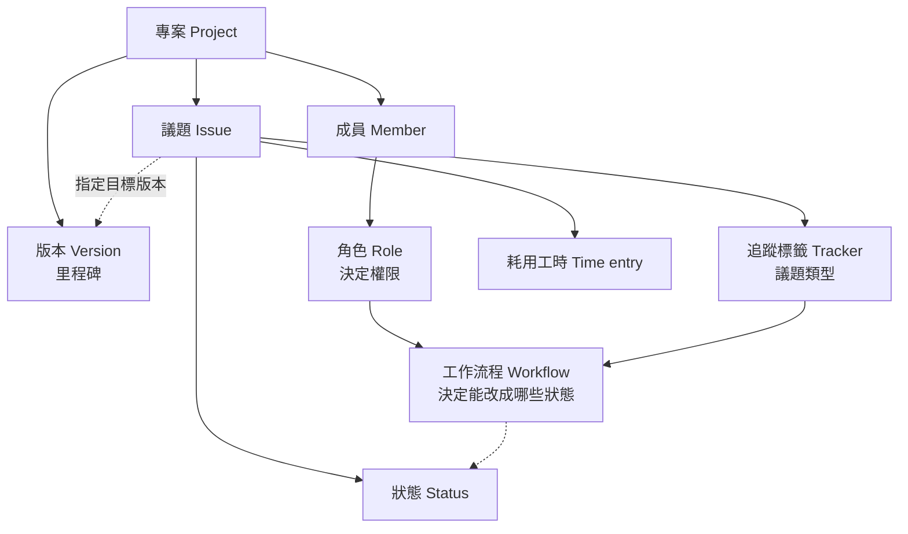
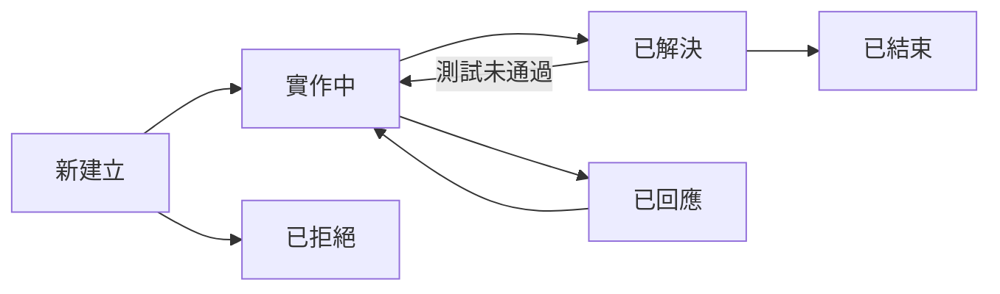

# 00 認識 Redmine

[← 回目錄](../README.md)

> **本章你會學到**：Redmine 是什麼、適合哪些團隊、它的核心概念如何串在一起，以及本教學的閱讀方式。

## 0.1 Redmine 是什麼

Redmine 是一套以網頁操作的**開源專案管理與議題追蹤系統**，使用 Ruby on Rails 開發，以 GPL v2 授權免費釋出，從 2006 年發展至今。它的核心是「議題」：把每一件待辦工作、每一個錯誤回報、每一項需求都記錄成一筆議題，再透過狀態、分派對象、版本與工時來追蹤進度。

除了議題追蹤，Redmine 還內建以下功能，每個專案可以自行決定要啟用哪些：

- **時程規劃**：甘特圖、行事曆、路線圖（依版本檢視進度）。
- **工時管理**：記錄每個人在每個議題上花了多少時間，並產生報表。
- **知識與文件**：每個專案都有自己的 Wiki、文件區、檔案區、新聞公告與討論區。
- **版本庫整合**：可連結 Git、Subversion 等版本庫，讓程式碼提交和議題互相關聯。
- **權限控管**：以「角色」為單位設定權限，同一個人在不同專案可以有不同身分。

## 0.2 適合與不適合的情況

**適合：**

- 需要**自行架設**、資料必須留在自己伺服器上的團隊，例如對資料保密有要求的企業、學校或公部門。
- 同時進行**多個專案**，需要統一管理成員與權限的組織。
- 需要**完整歷程**的工作，例如軟體開發、維運支援、客服工單、內部 IT 請求。
- 希望免授權費用，並且有人力可以維護一台伺服器的團隊。

**可能不適合：**

- 只想要簡單看板、沒有人力維護伺服器的小團隊，雲端服務型的工具會更省事。
- 非常重視介面美觀與拖拉操作的團隊。Redmine 預設介面偏傳統，看板等功能需要另外安裝外掛。

## 0.3 核心概念

Redmine 的概念彼此環環相扣，先理解它們的關係，後面各章會容易很多：

用一句話串起來就是：**專案**裡有**成員**，每個成員依**角色**擁有不同權限；成員建立**議題**，議題依**追蹤標籤**分類，並在**工作流程**允許的範圍內切換**狀態**，最後歸入某個**版本**交付，過程中花費的時間記成**耗用工時**。

一筆議題最常見的生命週期如下（使用載入預設組態後的狀態名稱，實際可用的狀態依各站台的設定而定）：

## 0.4 和其他工具的比較

| 比較項目 | Redmine | Jira | Trello |
|---|---|---|---|
| 費用 | 免費開源 | 依人數收費（有免費方案） | 有免費方案，進階功能收費 |
| 部署方式 | 自行架設 | 以雲端為主 | 雲端 |
| 擅長 | 議題追蹤、多專案、權限細緻、工時 | 敏捷開發流程、生態系完整 | 簡單直覺的看板 |
| 看板 | 需安裝外掛 | 內建 | 內建 |
| 維護成本 | 需要有人管理伺服器 | 低 | 低 |

> 以上為概略比較，各工具的方案與功能會隨時間調整，導入前請以各官方網站的最新資訊為準。

## 0.5 本教學的閱讀方式

- 每章開頭的「本章你會學到」列出重點，可以快速判斷是否需要讀。
- 標註「（5.0+）」表示 Redmine 5.0 以上才有的功能。
- 標註「需安裝外掛」表示不是 Redmine 內建的功能。
- 按鈕與選單名稱以「」標示，並照官方繁體中文翻譯書寫，例如「建立新議題」。內文說明則使用較口語的說法，兩者與英文介面的對照請見 [附錄 A](appendix-a-glossary.md)。
- 如果你想邊看邊操作，但手邊沒有 Redmine，可以先照著 [01 快速試用](01-quick-try.md) 在自己電腦上架一個。

---

下一章：[01 快速試用 →](01-quick-try.md)
