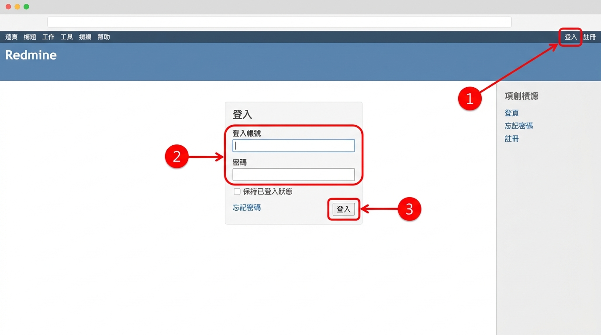
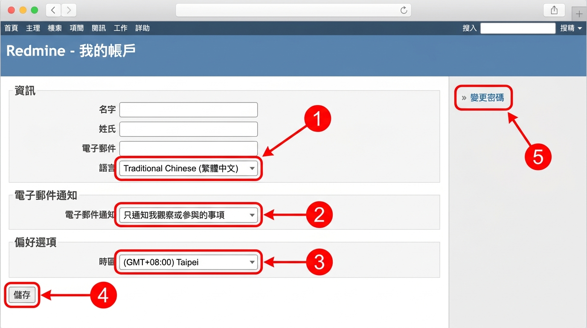
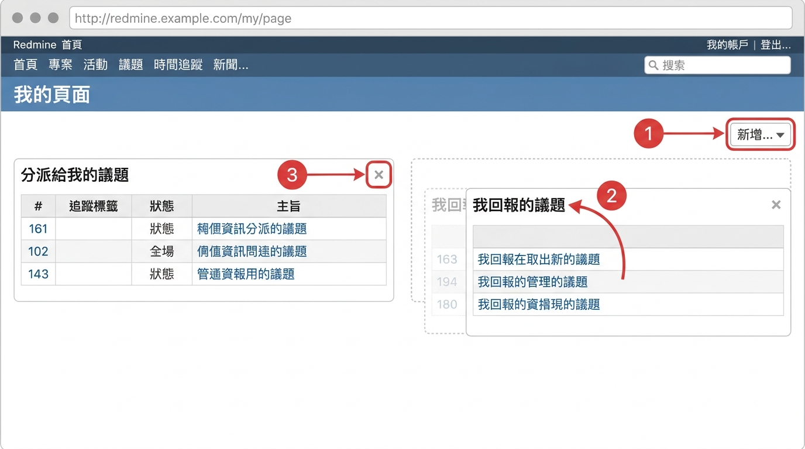

# 01 入門與介面導覽

[← 回目錄](../README.md)

## 1.1 登入系統

1. 在瀏覽器輸入公司 Redmine 網址。
2. 點選右上角的「登入」。
3. 輸入帳號與密碼，按下「登入」。
4. 若系統有開放註冊，可點「註冊」自行申請帳號，待管理員核准後即可使用。

## 1.2 認識畫面配置

Redmine 的畫面大致分成四個區域：

1. **頂端列**：左側有「首頁」、「我的頁面」、「專案」、「管理」（僅管理員可見），右側有目前登入帳號、「我的帳戶」與「登出」。
2. **專案標頭**：顯示目前所在專案名稱，右側有搜尋框與專案快速切換選單。
3. **專案頁籤**：進入專案後出現，例如「概觀」、「活動」、「路線圖」、「議題」、「耗用工時」、「甘特圖」、「行事曆」、「新聞」、「文件」、「Wiki」、「檔案」、「設定」。實際出現哪些頁籤取決於專案啟用的模組與你的權限。
4. **內容區與側邊欄**：主要操作區域，側邊欄會顯示篩選、捷徑或統計。

## 1.3 個人帳戶設定

1. 點選右上角「我的帳戶」。
2. 可修改姓名、電子郵件、介面語言（建議選「Traditional Chinese (繁體中文)」）。
3. 在「電子郵件通知」選擇你想收到哪些通知，例如「只通知我觀察或參與的事項」。
4. 在「偏好選項」可設定時區、留言排序方式。
5. 按下「儲存」。
6. 若要改密碼，點選右側的「變更密碼」。

> 建議每個人登入後第一件事就是確認時區與通知設定，避免日期錯亂或信箱被通知塞滿。

## 1.4 我的頁面

「我的頁面」是個人化的工作儀表板，可以集中查看與自己相關的資訊。

1. 點選頂端列的「我的頁面」。
2. 預設會看到「分派給我的議題」與「我回報的議題」。
3. 在右上角的下拉選單可加入其他區塊，例如「觀察中的議題」、「耗用工時」、「最新新聞」、「行事曆」。
4. 拖曳區塊標題可調整位置，點區塊右上角的「×」可移除。

---

下一章：[02 一般成員操作 →](02-member.md)
