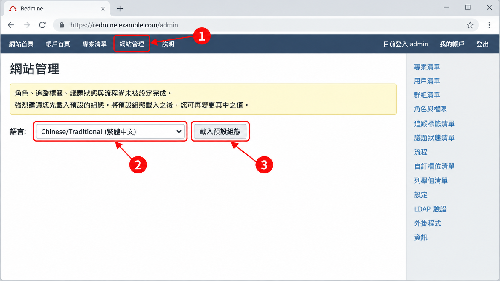

# 01 快速試用（選讀）

[← 回目錄](../README.md)

> **本章你會學到**：用 Docker 在自己的電腦上啟動一個 Redmine，載入預設設定、切換成繁體中文，並建立示範資料，讓你可以邊看教學邊操作。
>
> 如果你的公司或學校已經有 Redmine 可以用，可以直接跳到 [02 入門與介面導覽](02-getting-started.md)。

> ⚠️ 本章的做法只適合**個人試用與學習**。要給團隊正式使用，請參考 [09 伺服器維運](09-server-maintenance.md)，改用獨立資料庫並做好備份。

## 1.1 事前準備

你需要先在電腦上安裝 **Docker Desktop**（Windows、macOS）或 **Docker Engine**（Linux）。安裝方式請參考 Docker 官方網站。安裝完成後，打開終端機（Windows 可用 PowerShell）輸入以下指令，有出現版本號就代表安裝成功：

```bash
docker --version
```

## 1.2 啟動 Redmine

在終端機執行：

```bash
docker run -d --name my-redmine -p 3000:3000 redmine
```

這行指令的意思是：

- `docker run -d`：在背景啟動一個容器。
- `--name my-redmine`：把這個容器命名為 `my-redmine`，之後方便管理。
- `-p 3000:3000`：把電腦的 3000 埠對應到容器內的 Redmine。
- `redmine`：使用 Docker Hub 上的官方 Redmine 映像檔。沒有另外設定資料庫時，它會使用內建的 SQLite，適合試用。

第一次執行會先下載映像檔，需要等幾分鐘。之後打開瀏覽器，前往：

```
http://localhost:3000
```

看到 Redmine 首頁就代表啟動成功。如果頁面打不開，請等一分鐘再重新整理，Redmine 第一次啟動需要時間初始化資料庫。

## 1.3 首次登入

1. 點右上角「登入」（英文介面為 Sign in）。
2. 輸入預設的管理員帳號 `admin`，密碼 `admin`。
3. 系統會要求你立刻變更密碼，請設定一組新密碼。

> 預設帳密是公開資訊，任何架好的 Redmine 都應該第一時間更改，正式環境更是如此。

## 1.4 載入預設設定

全新安裝的 Redmine 沒有任何追蹤標籤、議題狀態與角色，必須先載入預設設定才能開始使用。

1. 點頂端列的「網站管理」（Administration）。
2. 畫面會提示「角色、追蹤標籤、議題狀態與流程尚未被設定完成」，在「語言」下拉選單選擇「Chinese/Traditional (繁體中文)」。
3. 按下「載入預設組態」（Load the default configuration）。

完成後，系統會建立以下預設資料，以及對應的工作流程：

| 類別 | 繁體中文預設名稱 | 英文 |
|---|---|---|
| 追蹤標籤 | 臭蟲、功能、支援 | Bug、Feature、Support |
| 議題狀態 | 新建立、實作中、已解決、已回應、已結束、已拒絕 | New、In Progress、Resolved、Feedback、Closed、Rejected |
| 角色 | 管理人員、開發人員、報告人員 | Manager、Developer、Reporter |
| 議題優先權 | 低、正常、高、速、急 | Low、Normal、High、Urgent、Immediate |
| 時間追蹤活動 | 設計、開發 | Design、Development |

本教學後續章節都使用這些預設名稱。這些名稱可以自由修改，例如很多站台會把「臭蟲」改成「錯誤」，改名方式見 [7.5 追蹤標籤](07-administrator.md#75-追蹤標籤)、[7.6 議題狀態](07-administrator.md#76-議題狀態)、[7.9 列舉值清單](07-administrator.md#79-列舉值清單)。



> 如果「網站管理」頁面沒有出現這個提示，代表預設設定已經載入過，可以直接略過這一步。

> 預設設定的名稱會依你選擇的語言建立。如果選錯語言，可以之後到「網站管理」中逐一改名，不需要重裝。

## 1.5 切換為繁體中文介面

1. 點右上角「我的帳戶」（My account）。
2. 在「語言」（Language）選擇「Chinese/Traditional (繁體中文)」。
3. 按「儲存」（Save）。

如果希望所有新使用者預設都是繁體中文，可以到「網站管理」→「設定」→「顯示」把「預設語言」也改成「Chinese/Traditional (繁體中文)」。

## 1.6 建立示範資料

為了讓後面的教學有東西可以操作，建議先建立一點示範資料：

1. 到「網站管理」→「用戶清單」新增兩、三位虛構的使用者，例如「王小明」、「李大華」。詳細步驟見 [7.2 使用者管理](07-administrator.md#72-使用者管理)。
2. 到「專案清單」→「建立新專案」，建立一個名為「官網改版 2026」的專案。詳細步驟見 [5.1 建立專案](05-project-manager.md#51-建立專案)。
3. 在專案中加入剛剛建立的使用者，並各建立幾筆議題。

這個示範專案和 [06 情境案例](06-case-study.md) 使用的是同一個情境，你可以照著那一章完整走一遍。

## 1.7 停止、重新啟動與移除

```bash
docker stop my-redmine     # 停止
docker start my-redmine    # 重新啟動，資料會保留
docker rm -f my-redmine    # 移除容器，裡面的資料會一起刪除
```

> 用本章方式建立的資料都存在容器裡，**移除容器資料就會消失**。這對試用來說很方便，但請不要把重要資料放在這裡。

---

上一章：[← 00 認識 Redmine](00-what-is-redmine.md)｜下一章：[02 入門與介面導覽 →](02-getting-started.md)
