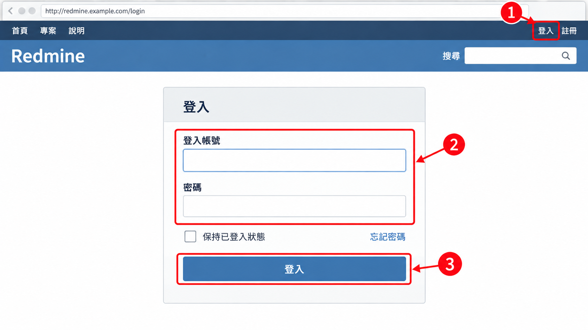
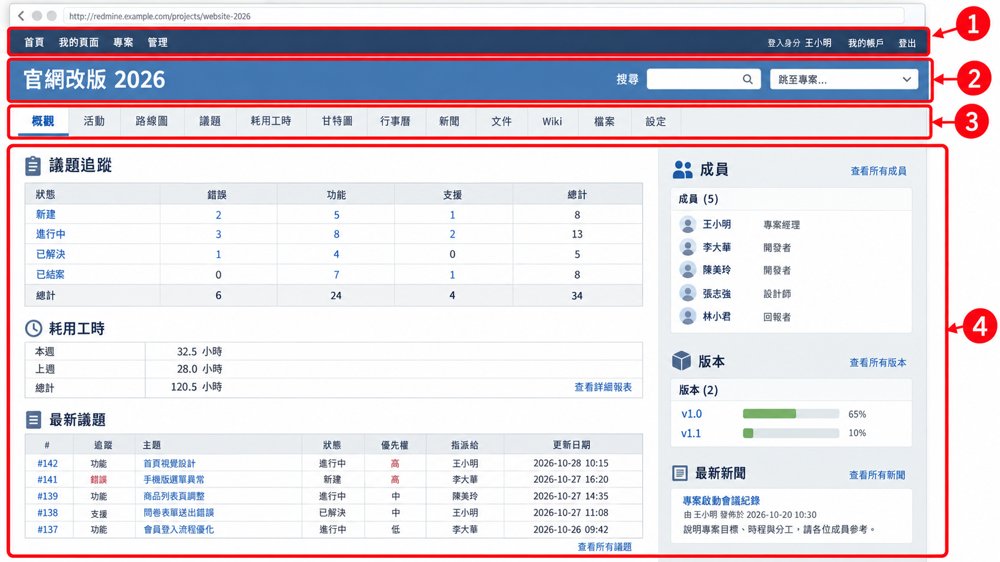
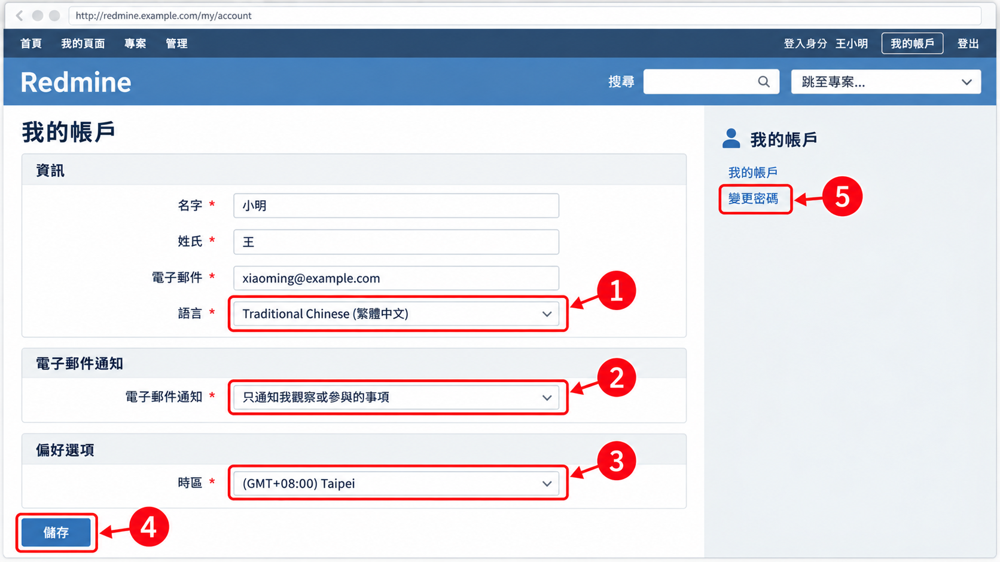
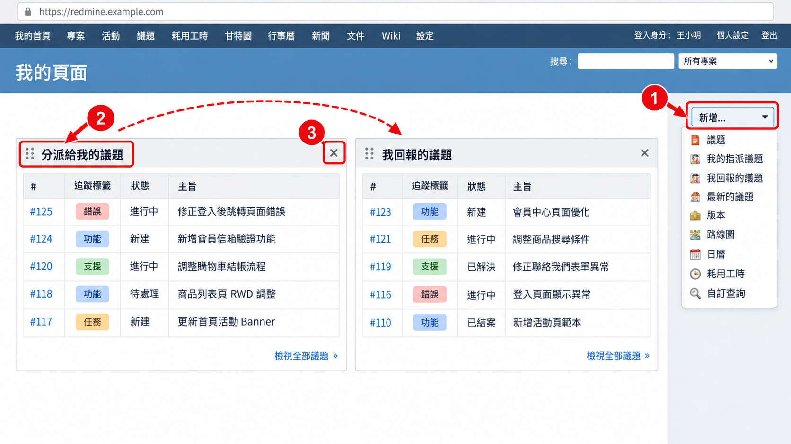

# 02 入門與介面導覽

[← 回目錄](../README.md)

> **本章你會學到**：登入 Redmine、認識畫面上各個區域、完成個人帳戶的基本設定，以及把「我的頁面」整理成自己的工作儀表板。

## 2.1 登入系統

1. 在瀏覽器輸入你所使用的 Redmine 網址（由系統管理員提供）。
2. 點選右上角的「登入」。
3. 輸入帳號與密碼，按下「登入」。
4. 若站台有開放註冊，可點「註冊」自行申請帳號。依站台設定不同，帳號可能需要點擊確認信或等管理員核准後才能使用。
5. 若站台啟用了雙因素驗證（4.2+），登入後還需要輸入驗證 App 上的 6 位數驗證碼。

> 忘記密碼時，可以點登入框下方的「遺失密碼」重設。如果沒有看到這個連結，代表管理員關閉了此功能，請直接聯絡管理員。

## 2.2 認識畫面配置

Redmine 的畫面大致分成四個區域：

1. **頂端列**：左側有「網站首頁」、「帳戶首頁」（也就是「我的頁面」）、「專案清單」、「網站管理」（僅管理員可見）、「說明」；右側有目前登入帳號、「我的帳戶」與「登出」。
2. **專案標頭**：顯示目前所在專案名稱，右側有搜尋框與「選擇欲前往的專案...」快速切換選單。
3. **專案頁籤**：進入專案後出現，例如「概觀」、「活動」、「版本藍圖」、「議題清單」、「耗用工時」、「甘特圖」、「日曆」、「新聞」、「文件」、「Wiki」、「檔案清單」、「設定」。實際出現哪些頁籤，取決於專案啟用的模組與你的權限。
4. **內容區與側邊欄**：主要操作區域，側邊欄會依頁面顯示篩選、捷徑或統計。

> **英文介面對照**：頂端列為 Home、My page、Projects、Administration、Help；專案頁籤為 Overview、Activity、Roadmap、Issues、Spent time、Gantt、Calendar、News、Documents、Wiki、Files、Settings。完整對照請見 [附錄 A](appendix-a-glossary.md)。

> 如果你的站台安裝了外掛或更換了佈景主題，可能會看到額外的頁籤（例如「看板」、「Agile」）或完全不同的配色，這是正常的。

## 2.3 個人帳戶設定

1. 點選右上角「我的帳戶」。
2. 可修改姓名、電子郵件、介面語言（繁體中文請選「Chinese/Traditional (繁體中文)」）。
3. 在「電子郵件提醒選項」選擇你想收到哪些通知，例如「只提醒我監看中或參與中的事物」。
4. 在「偏好選項」設定「時區」、「回應排序」等。
5. 按下「儲存」。
6. 若要改密碼，點選右側的「變更密碼」。

> 建議登入後第一件事就是確認**時區**與**通知設定**，避免日期錯亂，或信箱被通知信塞滿。

右側側邊欄還有幾個進階項目，之後用得到時再回來看：

- **雙因素驗證**（4.2+）：啟用後登入需要再輸入驗證碼，帳號更安全。是否可用依站台設定。
- **API 存取金鑰**：串接自動化工具時使用，詳見 [8.2 REST API](08-integration.md#82-rest-api)。

## 2.4 我的頁面

「我的頁面」（畫面上的名稱為「帳戶首頁」）是個人化的工作儀表板，可以集中查看與自己相關的資訊。

1. 點選頂端列的「帳戶首頁」。
2. 預設會看到「分派給我的議題」與「我通報的議題」。
3. 在右上角的「新增」下拉選單可加入其他區塊，例如「監看中的議題清單」、「耗用工時」、「最近新聞」、「日曆」，也可以加入你儲存的自訂查詢。
4. 拖曳區塊標題可調整位置，點區塊右上角的「×」可移除。

> 把每天要看的自訂查詢（例如「本週到期的議題」）加到我的頁面，登入後一眼就能掌握工作狀況。自訂查詢的建立方式見 [3.8 篩選議題清單](03-member.md#38-篩選議題清單)。

---

上一章：[← 01 快速試用](01-quick-try.md)｜下一章：[03 一般成員操作 →](03-member.md)
