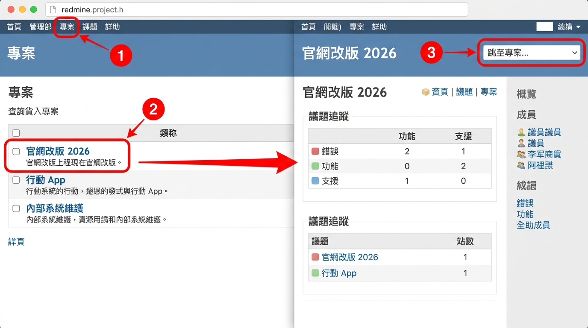
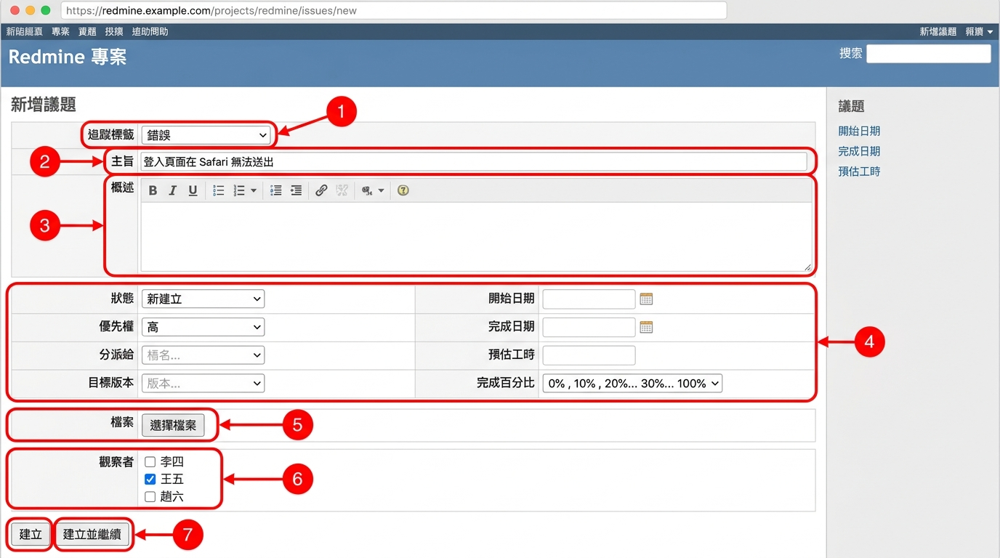
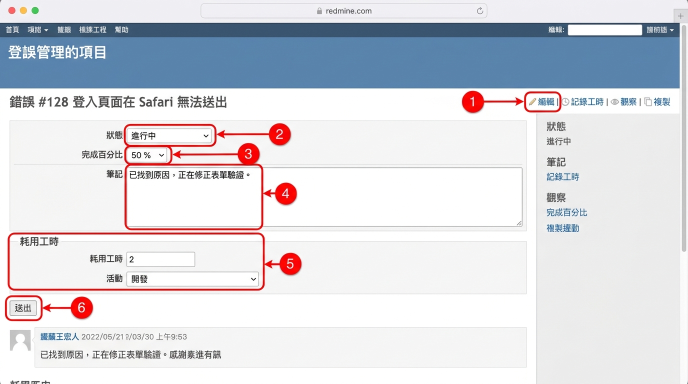
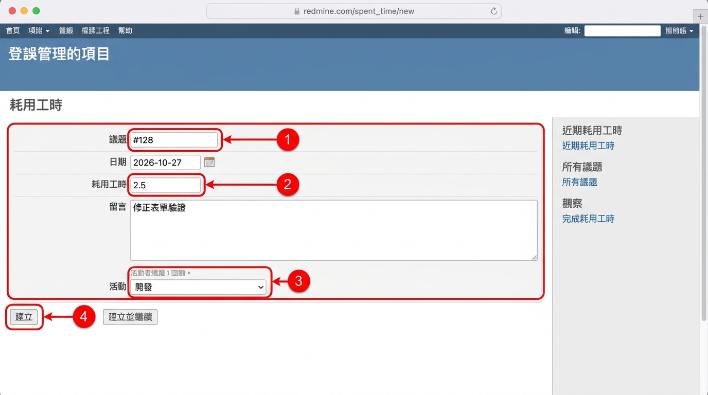
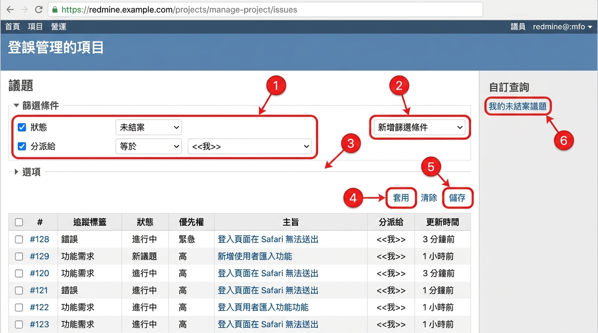

# 02 一般成員操作

[← 回目錄](../README.md)

## 2.1 進入專案

1. 點選頂端列的「專案」，即可看到你有權限的所有專案。
2. 點選專案名稱進入「概觀」頁，會看到專案描述、議題統計、成員清單與最新新聞。
3. 也可以用右上角的「跳至專案」下拉選單快速切換。

## 2.2 建立議題

1. 進入專案後，點選「議題」頁籤，再點右上角的「新增議題」（或直接點頂端的「＋」→「新增議題」）。
2. 填寫以下欄位：
   - **追蹤標籤**：選擇議題類型，例如「錯誤」或「功能」。
   - **主旨**：一句話描述問題或工作，例如「登入頁面在 Safari 無法送出」。
   - **概述**：詳細說明背景、重現步驟、預期結果與實際結果。
   - **狀態**：新議題通常為「新建立」。
   - **優先權**：低、正常、高、緊急、立刻。
   - **分派給**：負責處理的人，不確定時可留空讓專案經理分派。
   - **目標版本**、**開始日期**、**完成日期**、**預估工時**：依需要填寫。
3. 在「檔案」區可上傳截圖或附件。
4. 在「觀察者」區勾選需要知道進度的同事。
5. 按「建立」，或按「建立並繼續」接著新增下一筆。

> 好的議題主旨要讓人不打開內容也知道在講什麼。避免使用「有問題」、「請處理」這類模糊字眼。

## 2.3 更新議題與回報進度

1. 打開議題，點右上角的「編輯」。
2. 依進度修改「狀態」（例如由「新建立」改為「進行中」）與「完成百分比」。
3. 在「筆記」欄位寫下這次的進展或遇到的問題。
4. 若同時要記錄工時，可在下方的「耗用工時」區填寫時數與活動類別。
5. 按「送出」。所有變更會以歷程方式保留在議題下方，觀察者會收到通知。

> 只想留言不改欄位時，直接在筆記欄輸入後送出即可。若要回覆某則留言，可點該留言右上角的「引用」。

## 2.4 觀察議題

1. 打開議題，點右上角的「觀察」（星號圖示）。
2. 之後議題有任何變動，你都會收到電子郵件通知。
3. 再點一次「取消觀察」即可停止。

## 2.5 記錄工時

**方法一：從議題記錄**

1. 打開議題，點「記錄工時」。
2. 填寫日期、時數、留言與活動（例如「開發」、「設計」、「測試」）。
3. 按「建立」。

**方法二：從專案記錄**

1. 進入專案的「耗用工時」頁籤，點「記錄工時」。
2. 在「議題」欄輸入議題編號（可留空，代表記在專案本身）。
3. 填寫其他欄位後按「建立」。

## 2.6 篩選議題清單

1. 進入「議題」頁籤。
2. 在「篩選條件」區勾選條件，例如「狀態：未結案」、「分派給：<<我>>」。
3. 可從右側「新增篩選條件」下拉選單加入更多條件，例如追蹤標籤、目標版本、優先權。
4. 展開「選項」可選擇顯示欄位、分組依據與排序方式。
5. 按「套用」。
6. 常用的篩選可按「儲存」存成「自訂查詢」，之後在側邊欄直接點選。

## 2.7 搜尋

1. 在右上角搜尋框輸入關鍵字，按 Enter。
2. 若輸入 `#123`，會直接跳到編號 123 的議題。
3. 搜尋結果頁可限定範圍（目前專案或所有專案）與類型（議題、Wiki、新聞、文件等）。

---

上一章：[← 01 入門與介面導覽](01-getting-started.md)｜下一章：[03 專案經理操作 →](03-project-manager.md)
