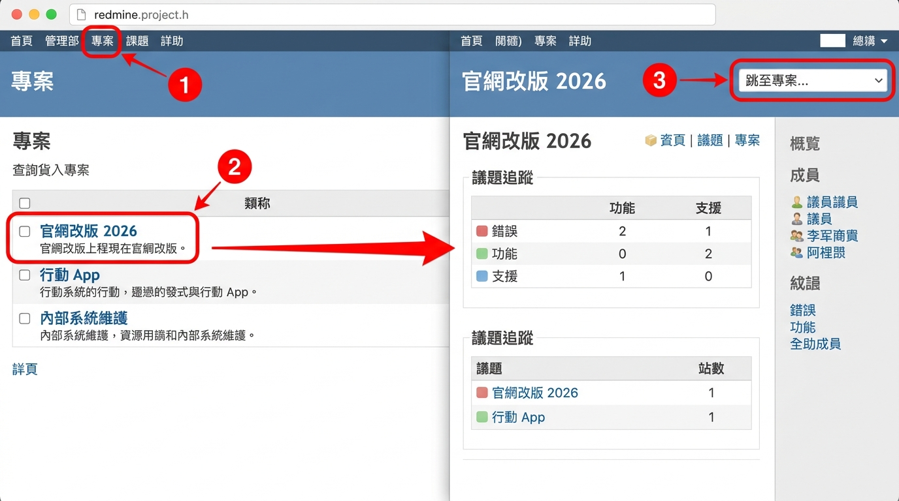
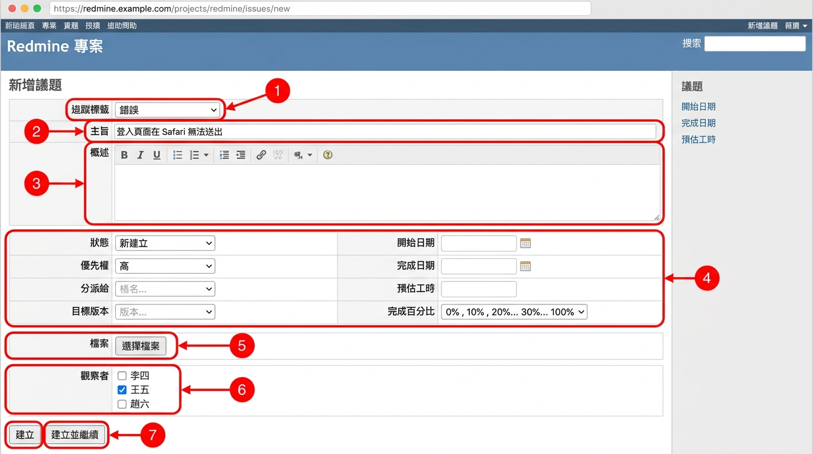
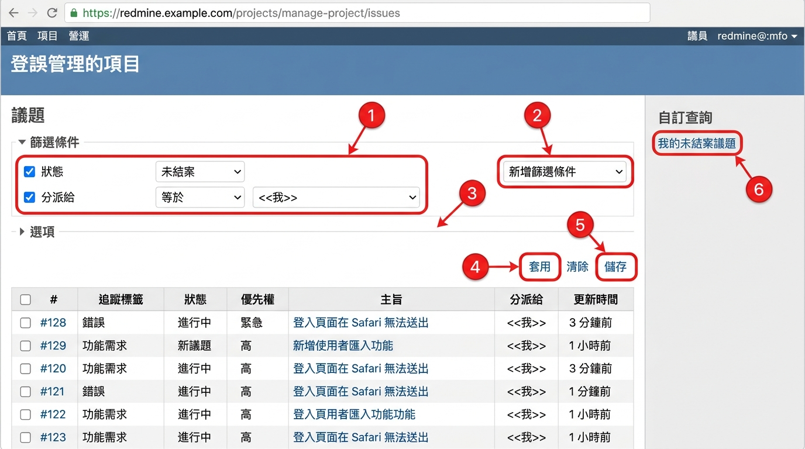

# 03 一般成員操作

[← 回目錄](../README.md)

> **本章你會學到**：建立一筆清楚的議題、回報進度、用 @ 提及同事、使用私人筆記、記錄工時、篩選與搜尋議題，以及把清單匯出成檔案。

## 3.1 進入專案

1. 點選頂端列的「專案清單」，即可看到你有權限的所有專案。
2. 點選專案名稱進入「概觀」頁，會看到專案描述、議題統計、成員清單與最新新聞。
3. 也可以用右上角的「選擇欲前往的專案...」下拉選單快速切換。



## 3.2 建立議題

1. 進入專案後，點選「議題清單」頁籤，再點右上角的「建立新議題」（或點專案頁籤最右邊的「+」→「建立新議題」；這個選單可由管理員在「設定」→「顯示」中關閉）。
2. 填寫以下欄位：
   - **追蹤標籤**：選擇議題類型，例如「臭蟲」或「功能」。
   - **主旨**：一句話描述問題或工作，例如「登入頁面在 Safari 無法送出」。
   - **概述**：詳細說明背景、重現步驟、預期結果與實際結果。可以使用文字格式，見 [04 文字格式與連結語法](04-formatting.md)。
   - **狀態**：新議題通常為「新建立」。
   - **優先權**：低、正常、高、速、急。
   - **被分派者**：負責處理的人，不確定時可留空讓專案經理分派。
   - **版本**（目標版本）、**開始日期**、**完成日期**、**預估工時**：依需要填寫。
3. 在「檔案」區可上傳截圖或附件，也可以直接把圖片拖曳到概述欄。
4. 在「監看員」區勾選需要知道進度的同事。
5. 按「建立」，或按「繼續建立」接著新增下一筆。



> 好的議題主旨要讓人不打開內容也知道在講什麼。避免使用「有問題」、「請處理」這類模糊字眼。

> 欄位會依站台設定而不同，有些站台會隱藏部分欄位，或加上公司自訂的欄位（例如「影響範圍」、「客戶名稱」）。

### 議題概述範本

以下範本可以直接複製到概述欄使用（以 Markdown 格式為例）。

**錯誤回報**

```markdown
### 問題描述
登入頁面在 Safari 按下「登入」後沒有反應。

### 重現步驟
1. 用 Safari 開啟登入頁
2. 輸入帳號密碼
3. 按下「登入」

### 預期結果
成功登入並進入首頁。

### 實際結果
按鈕沒有反應，也沒有錯誤訊息。

### 環境
- 瀏覽器：Safari 18
- 作業系統：macOS
- 發生頻率：每次都會
```

**功能需求**

```markdown
### 背景
目前客戶只能透過電話詢問訂單狀態，客服負擔很重。

### 需求
會員中心新增「訂單查詢」頁面，可查看近 6 個月的訂單與出貨狀態。

### 驗收條件
- [ ] 只顯示目前登入會員自己的訂單
- [ ] 可依日期排序
- [ ] 手機版排版正常
```

## 3.3 更新議題與回報進度

1. 打開議題，點右上角的「編輯」。
2. 依進度修改「狀態」（例如由「新建立」改為「實作中」）與「完成比例」（5.1、6.0 版為「完成百分比」）。
3. 在「筆記」欄位寫下這次的進展或遇到的問題。
4. 若同時要記錄工時，可在下方的「記錄時間」區填寫「耗用工時」與「活動」。
5. 按「送出」。所有變更會以歷程方式保留在議題下方，觀察者會收到通知。


> 只想留言不改欄位時，直接在筆記欄輸入後送出即可。若要回覆某則留言，可點該留言右上角的「引用」。

> 狀態下拉選單只會出現你被允許切換的選項，這是由管理員設定的工作流程（畫面上稱為「流程」）決定的。找不到想要的狀態時，請參考 [10 常見問題](10-faq.md)。

**用電子郵件回覆**：如果站台啟用了收信功能（見 [7.10 收信設定](07-administrator.md#710-收信設定)），你可以直接回覆議題的通知信，回信內容會自動成為該議題的一則筆記。寄件地址必須是你在 Redmine 帳戶中登記的電子郵件。

## 3.4 提及同事（5.0+）

在議題的概述或筆記中輸入 `@` 加上對方的登入帳號，例如 `@xiaoming`，輸入時會跳出名單讓你選擇。被提及的人會收到通知，即使他不是這個議題的觀察者。

適合用在需要特定人回覆或確認的時候，例如：

```
@dahua 這個錯誤只在正式環境出現，可以幫忙看一下伺服器的 log 嗎？
```

## 3.5 私人議題與私人筆記

**私人議題**：建立或編輯議題時勾選「私人」，這筆議題就只有作者、被分派者，以及角色權限設定為可看「所有議題」的人看得到。適合處理含有敏感資訊的問題，例如資安漏洞回報。

**私人筆記**：寫筆記時勾選筆記欄下方的「私人筆記」，這則筆記只有具備「檢視私人筆記」權限的角色看得到。適合團隊內部討論，而議題的回報者（例如客戶）不需要看到的內容。

> 這兩個選項是否出現，取決於你的角色是否有對應權限。沒有看到勾選框時，請洽專案經理或管理員。

## 3.6 觀察議題

1. 打開議題，點右上角的「監看」（星號圖示）。
2. 之後議題有任何變動，你都會收到電子郵件通知。
3. 再點一次「取消監看」即可停止。

## 3.7 記錄工時

**方法一：從議題記錄**

1. 打開議題，點「記錄時間」。
2. 填寫「日期」、「小時」、「回應」與「活動」（預設有「設計」、「開發」，其他活動可由管理員新增，見 [7.9 列舉值清單](07-administrator.md#79-列舉值清單)）。
3. 按「建立」。

**方法二：從專案記錄**

1. 進入專案的「耗用工時」頁籤，點「記錄時間」。
2. 在「議題」欄輸入議題編號（可留空，代表記在專案本身）。
3. 填寫其他欄位後按「建立」。


> 時數欄除了小數（例如 `1.5`），也可以輸入 `1h30m` 或 `1:30` 這類寫法。

## 3.8 篩選議題清單

1. 進入「議題清單」頁籤。
2. 在「篩選條件」區勾選條件，例如「狀態：進行中」、「被分派者：<<我自己>>」。
3. 可從右側「加入新篩選條件」下拉選單加入更多條件，例如追蹤標籤、版本、優先權、完成日期。
4. 展開「選項清單」可選擇顯示欄位、「結果分組方式」與排序方式，也可以勾選顯示「總計」（例如預估工時總和）。
5. 按「套用」。
6. 常用的篩選可按「儲存」存成「自訂查詢」，之後在側邊欄直接點選。

> 篩選「狀態」時，運算子「進行中」代表**所有尚未結束的狀態**（新建立、實作中、已回應等），「已結束」則代表所有已結束的狀態，不是指某一個特定狀態。



**常用篩選範例**

| 想看的內容 | 篩選條件 |
|---|---|
| 我手上還沒做完的工作 | 狀態：進行中、被分派者：<<我自己>> |
| 本週到期的議題 | 狀態：進行中、完成日期：本週 |
| 已逾期的議題 | 狀態：進行中、完成日期：大於幾天之前 1 天 |
| 最近 7 天新增的錯誤 | 追蹤標籤：臭蟲、建立日期：在過去幾天之內 7 天 |

## 3.9 搜尋

1. 在右上角搜尋框輸入關鍵字，按 Enter。
2. 若輸入 `#123` 或直接輸入數字 `123`，會跳到編號 123 的議題。
3. 搜尋結果頁可限定範圍（目前專案或所有專案）與類型（議題、Wiki、新聞、文件、版本庫等）。
4. 勾選「僅搜尋標題」可縮小範圍；預設勾選「包含全部的字詞」，多個關鍵字需全部符合。

## 3.10 匯出

議題清單、工時清單、單一議題都可以匯出，方便製作報告或交給沒有帳號的人看。

1. 在議題清單頁面套用好篩選條件。
2. 點頁面右下角「匯出至」後面的 **CSV**、**PDF** 或 **Atom**。
3. CSV 會跳出選項視窗，可選擇只匯出目前顯示的欄位或全部欄位，以及是否包含概述與筆記。

> 匯出的 CSV 用 Excel 開啟出現亂碼時，可以先用 Google 試算表或 Numbers 開啟，或在 Excel 用「資料 → 從文字/CSV」匯入並選擇 UTF-8 編碼。

> **Atom** 是訂閱格式，加到 RSS 閱讀器後，篩選結果有新變動時就會自動更新，不必一直登入查看。

---

上一章：[← 02 入門與介面導覽](02-getting-started.md)｜下一章：[04 文字格式與連結語法 →](04-formatting.md)
