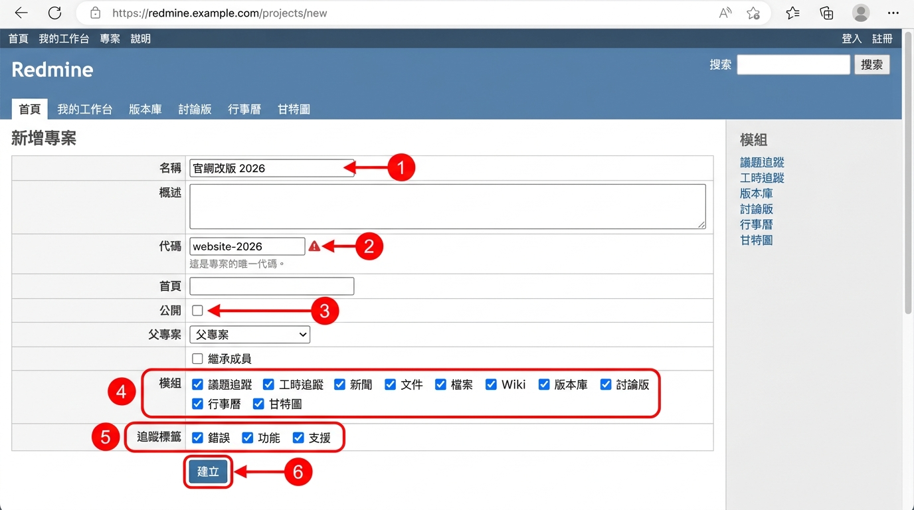
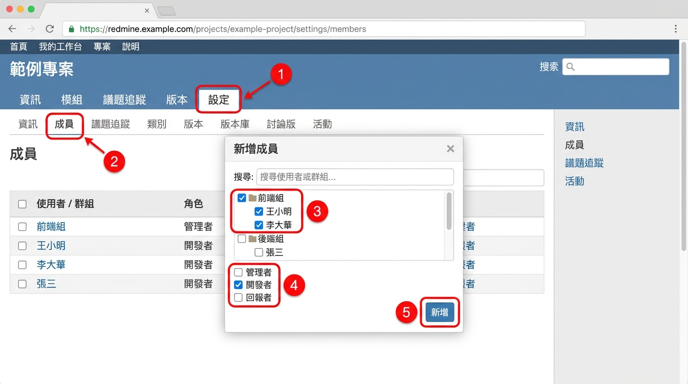
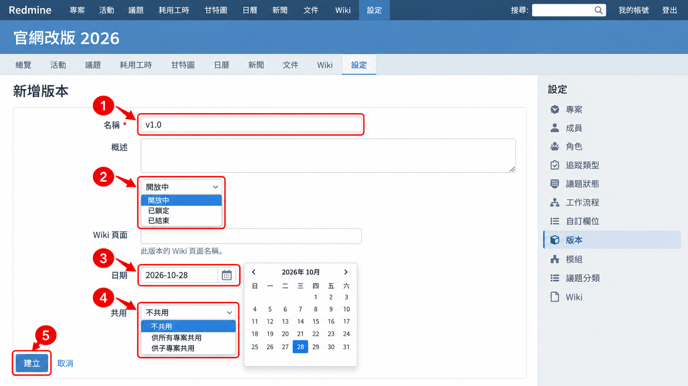
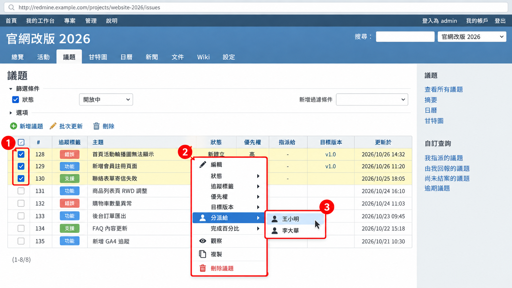
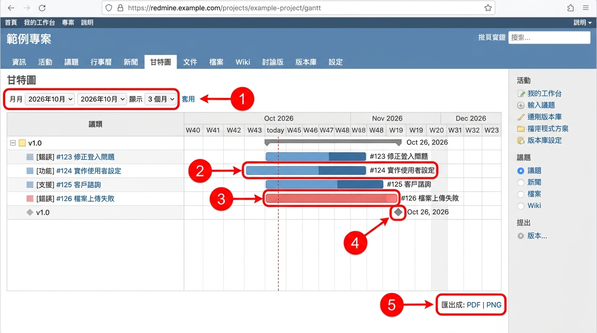
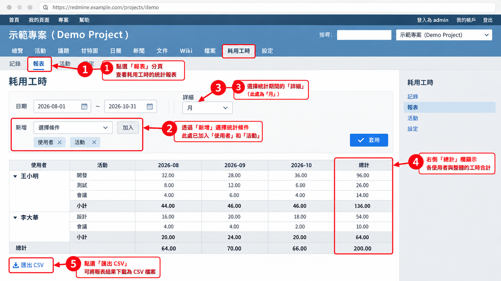

# 03 專案經理操作

[← 回目錄](../README.md)

> 本章操作需要「建立專案」權限，或在專案中具備「管理者」角色。若找不到相關按鈕，請洽系統管理員開通。

## 3.1 建立專案

1. 點選頂端列的「專案」，再點右上角的「新增專案」。
2. 填寫基本資料：
   - **名稱**：顯示用的專案名稱，例如「官網改版 2026」。
   - **概述**：專案目標與範圍說明，會顯示在概觀頁。
   - **代碼**：專案的英文識別碼，只能用小寫英數與 `-`、`_`，例如 `website-2026`。**建立後無法修改**，請謹慎命名。
   - **首頁**：專案相關網址（選填）。
   - **公開**：勾選後，所有登入者甚至訪客都能看到此專案。內部專案請不要勾選。
   - **父專案**：若此專案屬於某個大專案底下，在此選擇。
   - **繼承成員**：勾選後自動沿用父專案的成員。
3. 在「模組」區勾選要啟用的功能，例如議題追蹤、工時追蹤、Wiki、文件、檔案、甘特圖、行事曆。
4. 在「追蹤標籤」區勾選此專案會用到的議題類型。
5. 按「建立」。

## 3.2 加入專案成員

1. 進入專案的「設定」頁籤，切換到「成員」分頁。
2. 點「新增成員」。
3. 搜尋並勾選使用者或群組。
4. 勾選要給予的角色，例如「管理者」、「開發者」、「回報者」。一個人可以同時擁有多個角色。
5. 按「新增」。
6. 之後若要調整角色，在成員清單點「編輯」修改即可。

> 建議以「群組」加入成員，例如把整個「前端組」群組加入專案。之後組內有人異動，只要在後台調整群組即可，不必逐一修改每個專案。

## 3.3 設定版本（里程碑）

1. 在「設定」→「版本」分頁，點「新增版本」。
2. 填寫名稱（例如「v1.0」或「第一階段」）、概述、日期（預計完成日）。
3. **狀態** 說明：
   - 開放中：可以指派議題。
   - 已鎖定：不能再指派新議題，但已指派的仍保留。
   - 已結束：版本完成，不會出現在路線圖預設檢視中。
4. **共用** 可設定此版本是否給子專案或其他專案使用。
5. 按「建立」。

## 3.4 設定議題分類

1. 在「設定」→「議題分類」分頁，點「新增分類」。
2. 輸入分類名稱，例如「前端」、「後端」、「設計」。
3. 可指定「自動分派給」，之後選擇此分類的議題會自動分派給該成員。
4. 按「建立」。

## 3.5 分派與追蹤工作

1. 進入「議題」頁籤，篩選「分派給：無」找出尚未分派的議題。
2. 勾選多筆議題後**按右鍵**，可以批次修改分派對象、目標版本、優先權或狀態。
3. 設定「狀態：未結案」並以「分派給」分組，即可看到每個人手上的工作量。
4. 將此篩選儲存為自訂查詢，並勾選「對所有使用者可見」，團隊成員也能一起使用。

### 子議題與關聯議題

- **子議題**：大型工作可拆成多個子議題。在父議題頁面的「子議題」區點「新增」，父議題的進度與工時會自動彙總子議題。
- **關聯議題**：在議題頁面的「關聯的議題」區點「新增」，可設定「關聯到」、「重複」、「封鎖」（必須先完成對方）、「先於」（含日期間隔）等關係。

## 3.6 甘特圖

1. 進入「甘特圖」頁籤。
2. 調整上方的起始月份與顯示月數。
3. 甘特圖只會顯示**有填寫開始日期與完成日期**的議題，請確認議題日期已設定。
4. 灰色進度條代表完成百分比；紅色為逾期議題。
5. 可設定篩選條件，只看特定版本或特定人員。
6. 下方可匯出為 PDF 或 PNG，方便放進週報。

## 3.7 路線圖與行事曆

**路線圖**

1. 進入「路線圖」頁籤，可依版本查看完成進度條與每個版本底下的議題清單。
2. 側邊欄可勾選要顯示的追蹤標籤，或顯示已結束的版本。

**行事曆**

1. 進入「行事曆」頁籤，以月曆檢視議題的開始與完成日期，以及版本到期日。
2. 適合用來檢查某段時間的工作是否過度集中。

## 3.8 Wiki、文件與新聞

**Wiki**：適合撰寫會持續更新的知識，例如開發規範、部署步驟、會議記錄。

1. 進入「Wiki」頁籤，點「編輯」開始撰寫首頁內容。
2. 用 `[[頁面名稱]]` 建立新頁面連結，點擊連結即可建立該頁。
3. 用 `#123` 可直接連結議題。
4. 每次修改都會保存歷程，可比對差異或還原舊版。

**文件**：適合上傳正式文件，例如需求規格書、合約，並依分類整理。

**新聞**：用來發布專案公告，例如版本上線、會議通知，成員可以在新聞下方留言。

## 3.9 工時報表

1. 進入「耗用工時」頁籤，切換到「報表」分頁。
2. 點「新增」選擇統計維度，例如「使用者」、「議題」、「活動」、「版本」。
3. 選擇期間單位（年、月、週、日）。
4. 可匯出為 CSV，以試算表進一步分析。

---

上一章：[← 02 一般成員操作](02-member.md)｜下一章：[04 系統管理員操作 →](04-administrator.md)
