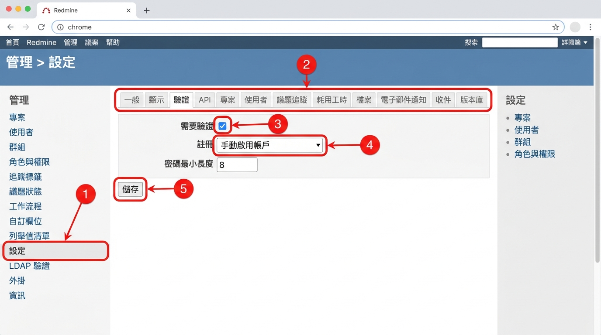
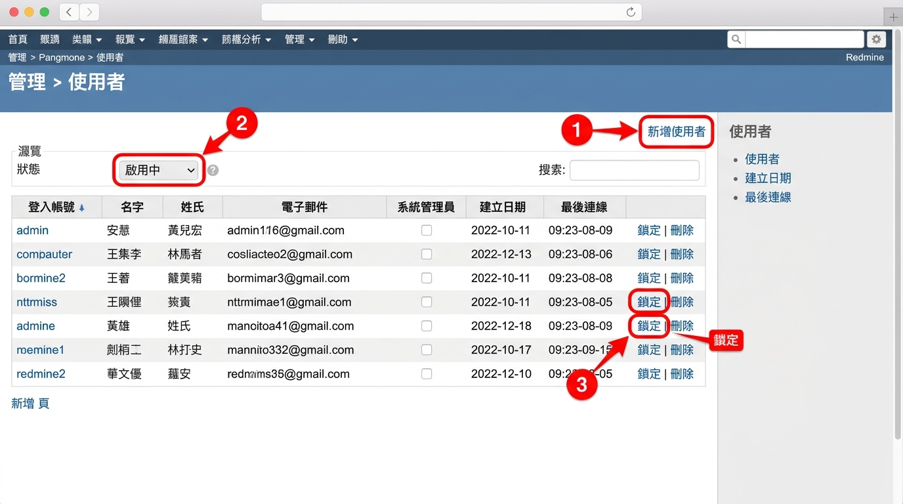
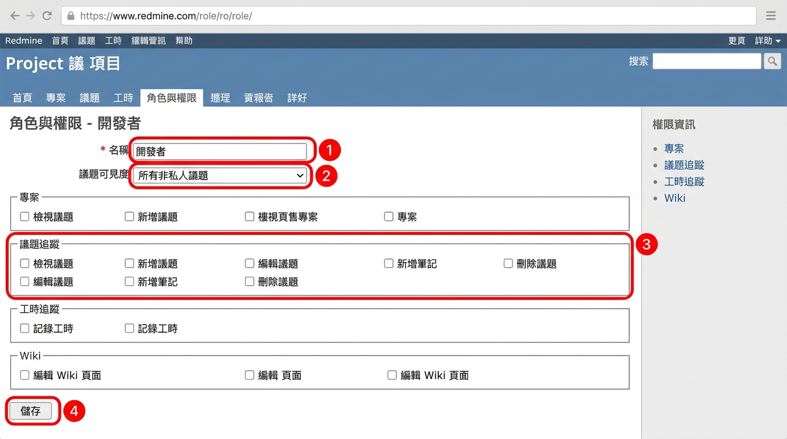
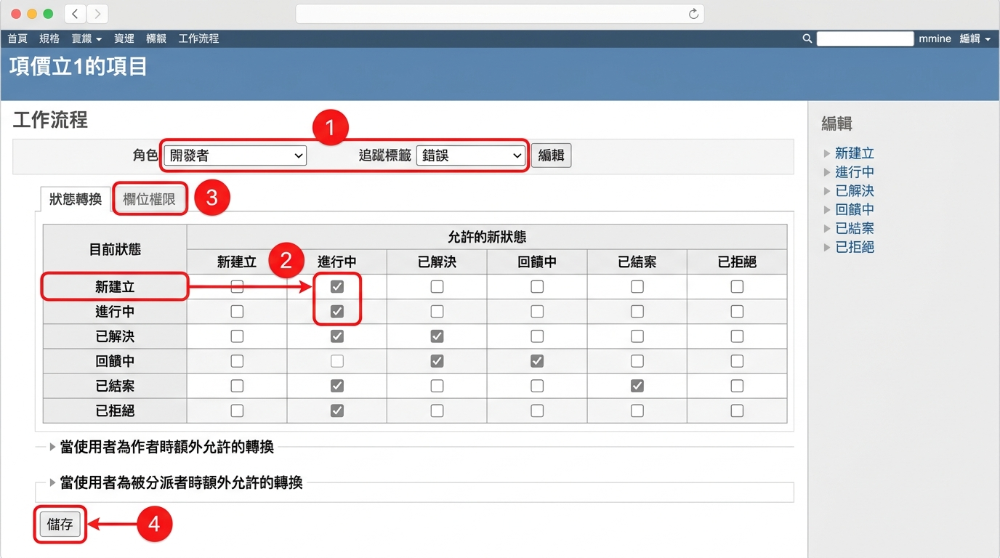
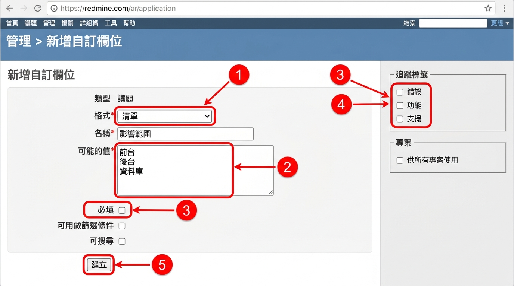

# 04 系統管理員操作

[← 回目錄](../README.md)

> 本章所有操作都在頂端列的「管理」選單內，只有系統管理員看得到。

## 4.0 建議的設定順序

初次架設 Redmine 時，建議依照以下順序設定，可以避免來回修改：

1. 系統設定（一般、驗證、電子郵件通知）
2. 議題狀態
3. 追蹤標籤
4. 角色與權限
5. 工作流程
6. 自訂欄位與列舉值清單
7. 使用者與群組
8. 建立專案並加入成員

## 4.1 系統設定

1. 進入「管理」→「設定」。
2. **一般** 分頁：設定應用程式標題、歡迎訊息、主機名稱與協定（影響通知信中的連結是否正確）。
3. **顯示** 分頁：預設語言設為「Traditional Chinese (繁體中文)」，設定日期與時間格式、使用者名稱顯示格式。
4. **驗證** 分頁：
   - 「需要驗證」：建議勾選，避免未登入者瀏覽內容。
   - 「註冊」：可選擇關閉、以電子郵件啟用帳戶、手動啟用帳戶、自動啟用帳戶。公司內部建議選「手動啟用帳戶」。
   - 密碼最小長度與必要字元類型。
5. **議題追蹤** 分頁：設定是否允許跨專案關聯、議題完成百分比計算方式等。
6. **電子郵件通知** 分頁：設定寄件者地址，並可按「寄送測試郵件」確認 SMTP 是否正常。



## 4.2 使用者管理

**新增使用者**

1. 進入「管理」→「使用者」，點「新增使用者」。
2. 填寫登入帳號、名字、姓氏、電子郵件。
3. 設定初始密碼，或勾選「產生密碼」並「傳送帳號資訊給使用者」。
4. 若此人需要管理後台，勾選「系統管理員」。
5. 按「建立」。

**停用使用者**

人員離職時，建議將狀態改為「鎖定」而非刪除，以保留其議題與工時歷史。

1. 在使用者清單找到該人員，點「鎖定」。



## 4.3 群組管理

1. 進入「管理」→「群組」，點「新增群組」。
2. 輸入群組名稱，例如「前端組」、「PM 組」，按「建立」。
3. 在「使用者」分頁加入成員。
4. 在「專案」分頁可直接將群組加入多個專案並指定角色。

## 4.4 角色與權限

1. 進入「管理」→「角色與權限」。
2. 系統預設有「管理者」、「開發者」、「回報者」三個角色，可直接修改或點「新增角色」。
3. 進入角色後，依模組勾選權限，例如：
   - **專案**：編輯專案、管理成員、管理版本。
   - **議題追蹤**：檢視議題、新增議題、編輯議題、新增筆記、刪除議題、管理子議題。
   - **工時追蹤**：記錄工時、檢視耗用工時、編輯自己的工時紀錄。
   - **Wiki**：檢視 Wiki 頁面、編輯 Wiki 頁面。
4. 「議題可見度」可設定為「所有議題」、「所有非私人議題」或「由該使用者建立或分派的議題」。
5. 按「儲存」。
6. 點清單下方的「權限報表」，可以用一張大表一次比較所有角色的權限。



> 「非成員」與「匿名使用者」是兩個特殊的內建角色，分別代表已登入但不是專案成員的人，以及未登入的訪客。若專案資料需保密，請確認這兩個角色的權限已收緊。

## 4.5 追蹤標籤

1. 進入「管理」→「追蹤標籤」，點「新增追蹤標籤」。
2. 輸入名稱，例如「錯誤」、「功能」、「任務」、「支援」。
3. 選擇「預設狀態」（新建議題時的初始狀態）。
4. 勾選此追蹤標籤要顯示的「標準欄位」與「自訂欄位」。
5. 勾選要套用的專案。
6. 按「建立」。

## 4.6 議題狀態

1. 進入「管理」→「議題狀態」，點「新增狀態」。
2. 輸入名稱，例如「待確認」、「測試中」。
3. 若此狀態代表工作已完成，勾選「已結案」。已結案的議題不會出現在「未結案」篩選中。
4. 可設定「完成百分比」，讓議題切換到此狀態時自動帶入進度（需在系統設定中將完成百分比計算方式設為「依議題狀態」）。
5. 用拖曳調整順序，順序會影響下拉選單的排列。

## 4.7 工作流程

工作流程決定「某個角色」在「某種追蹤標籤」上，可以把議題從哪個狀態改成哪個狀態。**新增追蹤標籤或狀態後，若沒有設定工作流程，使用者會無法變更議題狀態。**

1. 進入「管理」→「工作流程」。
2. 在上方選擇「角色」與「追蹤標籤」，按「編輯」。
3. 表格的列代表「目前狀態」，欄代表「新狀態」，勾選允許的轉換。
4. 下方兩個區塊可另外設定「當使用者為作者時」與「當使用者為被分派者時」額外允許的轉換。
5. 切換到「欄位權限」分頁，可設定某狀態下特定欄位為「唯讀」或「必填」，例如進入「已解決」時必須填寫解決說明。
6. 按「儲存」。
7. 若要複製現有設定，點右上角的「複製」，把某角色或追蹤標籤的流程套用到其他組合。



### 常見的工作流程範例

```
新建立 → 進行中 → 已解決 → 已結案
   ↓          ↓         ↓
  已拒絕    回饋中 → 進行中（退回重做）
```

- 開發者：可從「新建立」改為「進行中」、「進行中」改為「已解決」。
- 回報者：可從「已解決」改為「已結案」或退回「進行中」。
- 管理者：可做任何轉換。

## 4.8 自訂欄位

1. 進入「管理」→「自訂欄位」，點「新增自訂欄位」。
2. 選擇欄位要套用的物件，例如議題、專案、使用者、耗用工時。
3. 選擇格式：文字、長文字、整數、浮點數、日期、布林值、清單、使用者、版本、連結等。
4. 設定名稱、是否必填、是否可篩選、是否可搜尋。
5. 若為議題欄位，勾選要套用的追蹤標籤與專案（或勾選「供所有專案使用」）。
6. 可在「可見度」限定只有特定角色看得到。
7. 按「建立」。



## 4.9 列舉值清單

在「管理」→「列舉值清單」可維護以下下拉選項：

- **議題優先權**：例如低、正常、高、緊急、立刻。
- **文件分類**：例如需求文件、技術文件、會議記錄。
- **時間追蹤活動**：例如設計、開發、測試、會議。

每一類都可設定預設值、調整順序，或停用不再使用的選項。

## 4.10 其他管理功能

- **外掛**：查看已安裝的外掛及其設定。外掛需由伺服器端安裝，無法從介面上傳。
- **資訊**：查看 Redmine 版本、Ruby 與 Rails 版本、資料庫類型，以及檔案目錄的寫入權限檢查，回報問題時常需提供這些資訊。
- **專案**：列出所有專案，可封存、取消封存、複製或刪除專案。封存的專案為唯讀，不會出現在一般清單中。

---

上一章：[← 03 專案經理操作](03-project-manager.md)｜下一章：[05 常見問題 →](05-faq.md)
