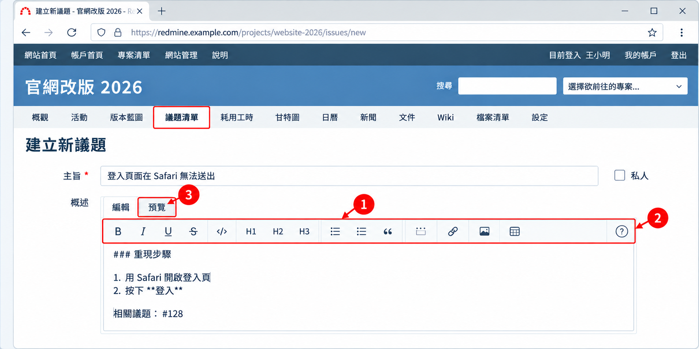

# 04 文字格式與連結語法

[← 回目錄](../README.md)

> **本章你會學到**：確認站台使用哪一種文字格式、最常用的排版語法、嵌入圖片、連結議題與 Wiki 等內容，以及幾個好用的巨集。

議題概述、筆記、Wiki、新聞、文件說明等欄位，都可以使用文字格式來排版。

## 4.1 先確認你的站台用哪一種格式

Redmine 支援以下幾種格式，由系統管理員在「網站管理」→「設定」→「一般」→「文字格式」統一設定：

| 格式 | 說明 |
|---|---|
| **CommonMark Markdown**（5.0+） | 目前建議使用的格式，語法和 GitHub 相同，6.0 起為新站台的預設值 |
| **Textile** | Redmine 早期的預設格式，舊站台常見 |
| Markdown（舊版） | 5.x 已不建議使用，**6.0 起已移除**；從 5.x 升級的站台需改用 CommonMark Markdown |
| 無 | 純文字，不支援任何排版 |

**怎麼知道自己的站台用哪一種？** 打開任一議題的編輯畫面，點編輯工具列最右邊的「?」說明圖示，跳出的說明頁會顯示目前使用的格式。



> 工具列上的按鈕會自動套用正確的語法，記不住語法時直接用工具列即可。寫完可以點「預覽」確認效果再送出。

> **給管理員**：更換格式不會自動轉換既有內容，已經用 Textile 寫好的舊議題在切換成 Markdown 後可能排版跑掉。建議在建站初期就決定好。

## 4.2 常用排版語法

| 效果 | CommonMark Markdown | Textile |
|---|---|---|
| **粗體** | `**粗體**` | `*粗體*` |
| *斜體* | `*斜體*` | `_斜體_` |
| ~~刪除線~~ | `~~刪除線~~` | `-刪除線-` |
| 行內程式碼 | `` `code` `` | `@code@` |
| 大標題 | `# 標題` | `h1. 標題` |
| 小標題 | `## 標題` | `h2. 標題` |
| 項目清單 | `- 項目` | `* 項目` |
| 編號清單 | `1. 項目` | `# 項目` |
| 引用 | `> 引用文字` | `bq. 引用文字` |
| 外部連結 | `[顯示文字](https://example.com)` | `"顯示文字":https://example.com` |
| 分隔線 | `---` | `---` |

**表格**

CommonMark Markdown：

```markdown
| 項目 | 負責人 | 狀態 |
|---|---|---|
| 首頁設計 | 陳美玲 | 完成 |
| 會員中心 | 李大華 | 進行中 |
```

Textile：

```textile
|_. 項目 |_. 負責人 |_. 狀態 |
| 首頁設計 | 陳美玲 | 完成 |
| 會員中心 | 李大華 | 進行中 |
```

**程式碼區塊**（可指定語言以顯示語法顏色）

CommonMark Markdown：

````markdown
```javascript
function hello() {
  console.log("Hello Redmine");
}
```
````

Textile：

```textile
<pre><code class="javascript">
function hello() {
  console.log("Hello Redmine");
}
</code></pre>
```

## 4.3 嵌入圖片

先把圖片上傳為議題或 Wiki 頁面的附件，再用檔名嵌入：

| 效果 | CommonMark Markdown | Textile |
|---|---|---|
| 嵌入附件圖片 | `` | `!screenshot.png!` |
| 嵌入縮圖（點擊放大） | `{{thumbnail(screenshot.png)}}` | `{{thumbnail(screenshot.png)}}` |

> 新版 Redmine 可以直接把圖片拖曳或貼上到編輯區，系統會自動上傳並插入語法。

## 4.4 連結 Redmine 內的其他內容

以下語法在各種格式中都通用：

| 語法 | 效果 |
|---|---|
| `#123` | 連結到議題 #123 |
| `##123` | 連結到議題 #123，並顯示追蹤標籤與主旨 |
| `#123-4` | 連結到議題 #123 的第 4 則筆記 |
| `[[頁面名稱]]` | 連結到同專案的 Wiki 頁面，頁面不存在時點擊即可建立 |
| `[[頁面名稱\|顯示文字]]` | 連結到 Wiki 頁面，但顯示自訂文字 |
| `[[專案代碼:頁面名稱]]` | 連結到其他專案的 Wiki 頁面 |
| `version:"v1.0"` | 連結到版本 |
| `document:"規格書"` | 連結到文件 |
| `attachment:report.pdf` | 連結到附件 |
| `project:website-2026` | 連結到專案 |
| `user:xiaoming` | 連結到使用者 |
| `@xiaoming` | 提及使用者並通知對方（5.0+） |
| `r100` | 連結到版本庫的修訂版 100（Subversion） |
| `commit:a1b2c3d` | 連結到版本庫的某次提交（Git） |

> 想要原樣顯示這些語法、不要變成連結時，在前面加上驚嘆號，例如 `!#123`。

## 4.5 好用的巨集

巨集用兩組大括號包住，可以在內容中插入特殊區塊：

| 巨集 | 效果 |
|---|---|
| `{{toc}}` | 自動產生目錄，適合放在長篇 Wiki 頁面最上方 |
| `{{child_pages}}` | 列出目前 Wiki 頁面的子頁面 |
| `{{include(頁面名稱)}}` | 把另一個 Wiki 頁面的內容嵌入這裡 |
| `{{thumbnail(圖片檔名)}}` | 顯示附件圖片的縮圖 |
| `{{collapse(標題)...}}` | 可展開與收合的區塊，用法見下方 |

**可收合區塊**的寫法：

```
{{collapse(點此查看完整錯誤訊息)
這裡是很長的錯誤訊息……
}}
```

適合放很長的錯誤記錄、設定檔內容等，不會讓議題頁面變得太長。

---

上一章：[← 03 一般成員操作](03-member.md)｜下一章：[05 專案經理操作 →](05-project-manager.md)
