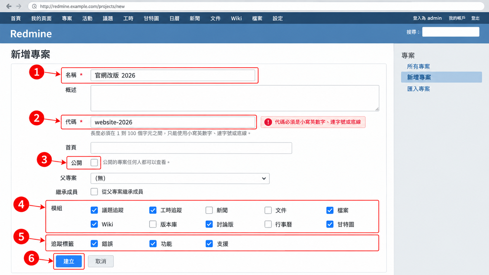
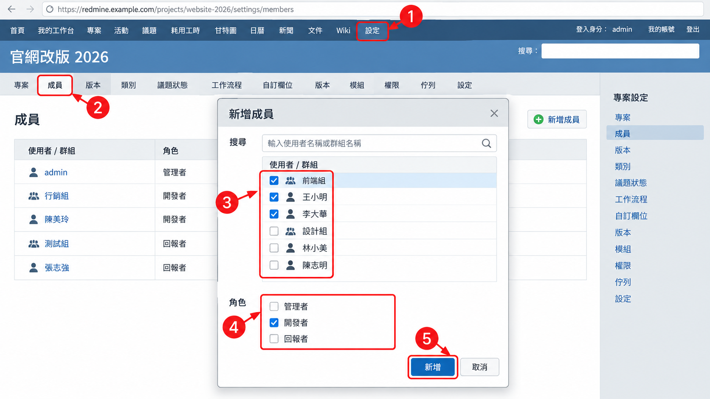
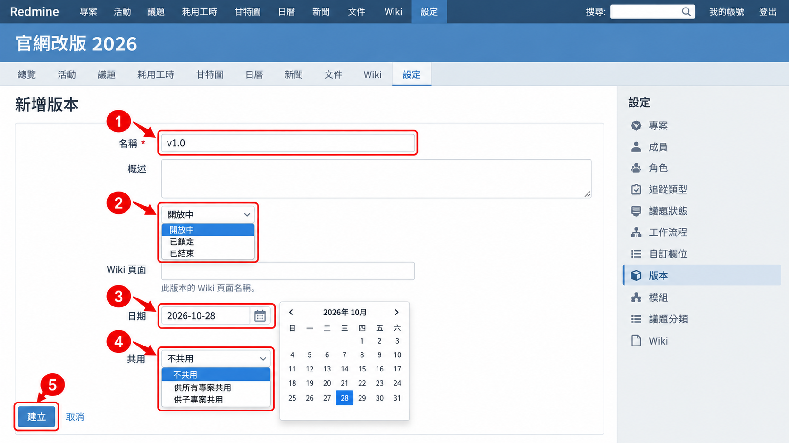
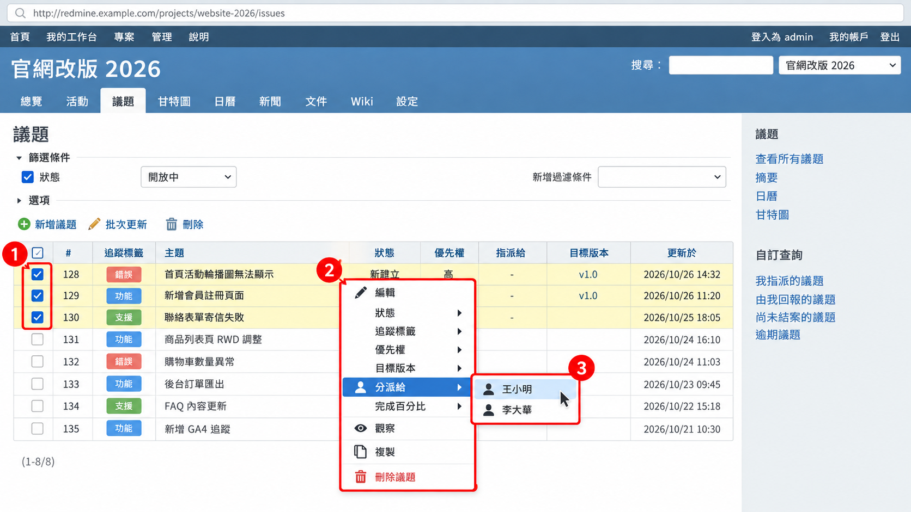
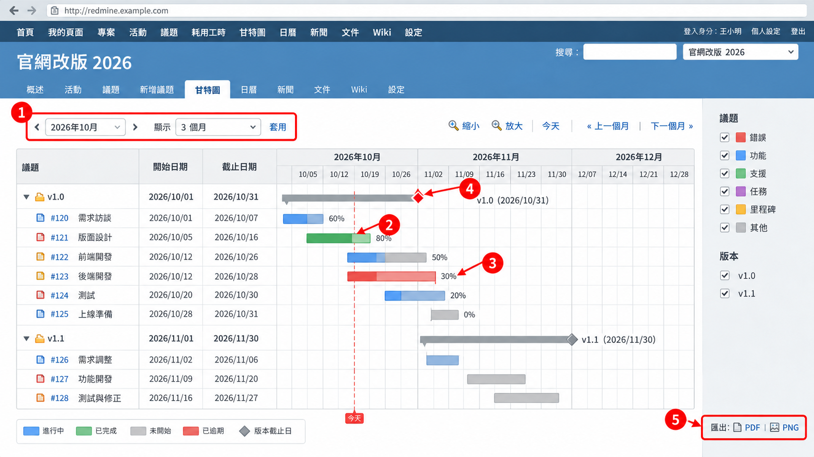
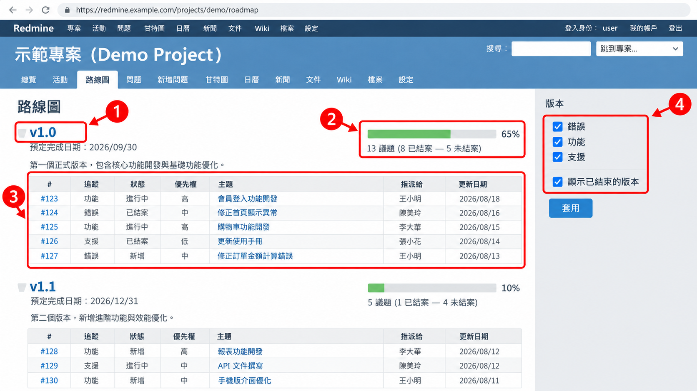
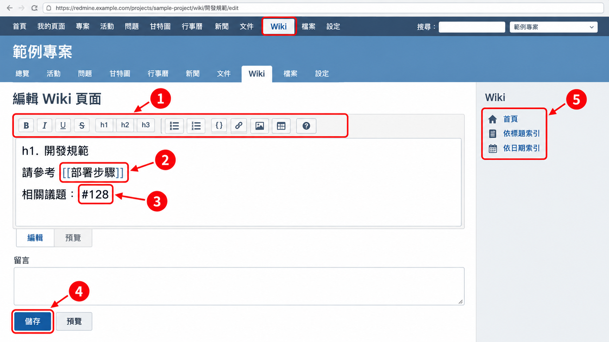

# 05 專案經理操作

[← 回目錄](../README.md)

> **本章你會學到**：建立專案、加入成員、規劃版本、分派與追蹤工作、拆解子議題、使用甘特圖與路線圖掌握進度、整理 Wiki，以及專案結束後的收尾。

> 本章操作需要「建立專案」權限，或在專案中具備「管理人員」角色。若找不到相關按鈕，請洽系統管理員開通。

## 5.1 建立專案

1. 點選頂端列的「專案清單」，再點右上角的「建立新專案」。
2. 填寫基本資料：
   - **名稱**：顯示用的專案名稱，例如「官網改版 2026」。
   - **概述**：專案目標與範圍說明，會顯示在概觀頁。
   - **代碼**：專案的英文識別碼，只能用小寫英數與 `-`、`_`，例如 `website-2026`。會出現在網址中，**建立後無法修改**，請謹慎命名。
   - **網站首頁**：專案相關網址（選填）。
   - **公開**：勾選後，所有登入者都能看到此專案；若站台允許匿名瀏覽，連未登入的訪客也看得到。內部專案請不要勾選。
   - **父專案**：若此專案屬於某個大專案底下，在此選擇。
   - **繼承父專案成員**：勾選後自動沿用父專案的成員。
3. 在「模組」區勾選要啟用的功能，例如「議題追蹤」、「工時追蹤」、「Wiki」、「文件」、「檔案」、「甘特圖」、「日曆」。不用的模組不要勾，介面會更簡潔。
4. 在「追蹤標籤」區勾選此專案會用到的議題類型。
5. 按「建立」。

> **公開專案的用途**：開源專案、對外的客服支援專案適合設為公開，讓外部使用者也能回報問題。公司內部專案則建議一律不公開。

## 5.2 加入專案成員

1. 進入專案的「設定」頁籤，切換到「成員」分頁。
2. 點「建立新成員」。
3. 搜尋並勾選使用者或群組。
4. 勾選要給予的角色，例如「管理人員」、「開發人員」、「報告人員」。一個人可以同時擁有多個角色。
5. 按「新增」。
6. 之後若要調整角色，在成員清單點「編輯」修改即可。

> 建議以「群組」加入成員，例如把整個「前端組」群組加入專案。之後組內有人異動，只要在後台調整群組即可，不必逐一修改每個專案。群組需由系統管理員建立，見 [7.3 群組管理](07-administrator.md#73-群組管理)。

## 5.3 設定版本（里程碑）

1. 在「設定」→「版本」分頁，點「建立新版本」。
2. 填寫名稱（例如「v1.0」或「第一階段」）、概述、日期（預計完成日）。
3. **狀態** 說明：
   - 「進行中」：可以指派議題。
   - 「已鎖定」：不能再指派新議題，但已指派的仍保留。
   - 「已結束」：版本完成，不會出現在版本藍圖的預設檢視中。
4. **共用** 可設定此版本是否給子專案或其他專案使用（「不共用」、「與子專案共用」、「與專案階層架構共用」、「與專案樹共用」、「與全部的專案共用」）。
5. 按「建立」。

> 版本不一定要是軟體版本號。非軟體專案可以用「第一階段」、「2026 Q4」、「上線前準備」這類名稱，把它當成里程碑使用。

## 5.4 設定議題分類

1. 在「設定」→「議題分類清單」分頁，點「建立新分類」。
2. 輸入分類名稱，例如「前端」、「後端」、「設計」。
3. 可指定「被分派者」，之後選擇此分類的議題會自動分派給該成員。
4. 按「建立」。

## 5.5 分派與追蹤工作

1. 進入「議題清單」頁籤，篩選「被分派者：空值」找出尚未分派的議題。
2. 勾選多筆議題後**按右鍵**，可以批次修改分派對象、目標版本、優先權或狀態。
3. 設定「狀態：進行中」並以「被分派者」分組，即可看到每個人手上的工作量。
4. 將此篩選儲存為自訂查詢，並把可見度設為「任何用戶均可見」或「僅選取之角色可見」，團隊成員也能一起使用。

**專案經理常用的自訂查詢**

| 查詢名稱 | 篩選條件 | 選項 |
|---|---|---|
| 待分派 | 狀態：進行中、被分派者：空值 | 依優先權排序 |
| 各人工作量 | 狀態：進行中 | 以「被分派者」分組，顯示預估工時總計 |
| 已逾期 | 狀態：進行中、完成日期：大於幾天之前 1 天 | 依完成日期排序 |
| 本版本進度 | 目標版本：v1.0 | 以「狀態」分組 |

## 5.6 子議題與關聯議題

**子議題**：適合把一件大工作拆成多個小工作，分給不同人負責。

1. 打開父議題，在「子任務」區點「新增」。
2. 填寫子議題內容後建立，它會自動掛在父議題底下。
3. 父議題的開始日期、完成日期、完成百分比、預估工時，預設會依子議題自動計算（計算方式可由管理員在「議題追蹤」設定中調整）。

> 拆解建議：子議題的大小以「一個人在幾天內能完成」為原則，太大的子議題可以再往下拆。但層級不要超過三層，否則反而難以追蹤。

**關聯議題**：適合描述兩筆獨立議題之間的關係。在議題頁面的「相關的議題清單」區點「新增」，可選擇：

| 關聯類型 | 意義 | 使用時機 |
|---|---|---|
| 關聯至 | 兩者相關 | 純粹提醒彼此有關 |
| 已重複 / 與後面所列議題重複 | 是同一件事 | 有人重複回報同一個錯誤，結案其中一筆 |
| 阻擋 / 被阻擋 | 必須先完成對方 | A 沒完成前 B 無法結案 |
| 優先於 / 跟隨於 | 有先後順序，可設定間隔天數 | 對方的日期變動時，本議題的日期會自動跟著調整 |
| 複製於 / 複製到 | 由複製功能建立 | 系統自動產生 |

## 5.7 甘特圖

1. 進入「甘特圖」頁籤。
2. 調整上方的起始月份與顯示月數。
3. 甘特圖只會顯示**有填寫開始日期與完成日期**的議題，請確認議題日期已設定。
4. 每條橫條代表一筆議題的期間：已完成的比例以較深的顏色填滿，逾期的部分會以紅色顯示；菱形代表版本的到期日，虛線代表今天。
5. 可設定篩選條件，只看特定版本或特定人員。
6. 下方可匯出為 PDF 或 PNG，方便放進週報（PNG 匯出需要伺服器有安裝 ImageMagick，若沒有這個選項請洽管理員）。

> 預設佈景主題中，未完成部分為灰色、已完成部分為綠色、逾期部分為紅色。更換佈景主題後顏色可能不同。

## 5.8 路線圖與行事曆

**路線圖**

1. 進入「版本藍圖」頁籤，可依版本查看完成進度條與每個版本底下的議題清單。
2. 側邊欄可勾選要顯示的追蹤標籤，或顯示已結束的版本。

**行事曆**

1. 進入「日曆」頁籤，以月曆檢視議題的開始與完成日期，以及版本到期日。
2. 適合用來檢查某段時間的工作是否過度集中。

## 5.9 Wiki、文件與新聞

**Wiki**：適合撰寫會持續更新的知識，例如開發規範、部署步驟、會議記錄。

1. 進入「Wiki」頁籤，點「編輯」開始撰寫首頁內容。
2. 用 `[[頁面名稱]]` 建立新頁面連結，點擊連結即可建立該頁。
3. 用 `#123` 可直接連結議題。
4. 每次修改都會保存歷程，可比對差異或還原舊版。
5. 側邊欄的「依標題索引」可以看到所有頁面，在頁面的「重新命名」中也可以調整上層頁面，整理成樹狀結構。

> 更多排版語法與 `{{toc}}`、`{{child_pages}}` 等巨集，請見 [04 文字格式與連結語法](04-formatting.md)。

**文件**：適合上傳正式文件，例如需求規格書、合約，並依分類整理。

**新聞**：用來發布專案公告，例如版本上線、會議通知，成員可以在新聞下方留言。

## 5.10 工時報表

1. 進入「耗用工時」頁籤，切換到「報告」分頁。
2. 在「新增」下拉選單選擇統計維度，例如「用戶」、「議題」、「活動」、「版本」。
3. 在「明細」選擇期間單位（年、月、週、天）。
4. 可匯出為 CSV，以試算表進一步分析。

## 5.11 複製專案作為範本

如果團隊常開性質相同的專案（例如每季一次的活動、固定流程的客戶導入），可以先建立一個「範本專案」，設定好模組、追蹤標籤、成員、版本、議題分類與常用 Wiki 頁面，之後直接複製。

1. 由系統管理員到「網站管理」→「專案清單」，找到範本專案，點「複製」。
2. 輸入新專案的名稱與代碼。
3. 勾選要一起複製的內容，例如成員、版本、議題分類、議題、Wiki、自訂查詢。
4. 按「複製」。

> 建議把範本專案的名稱加上「[範本]」並設為不公開，避免成員誤把議題建在範本裡。

## 5.12 結束與封存專案

專案完成後，有兩種收尾方式：

| 方式 | 誰可以操作 | 效果 |
|---|---|---|
| **關閉**（結束） | 具備「關閉 / 重新開啟專案」權限的成員，或系統管理員 | 專案變成唯讀，仍可瀏覽與搜尋，但不能新增或修改議題。可隨時「重新開啟」 |
| **封存** | 系統管理員 | 專案從清單中隱藏，一般使用者完全看不到。可由管理員取消封存 |

- 「關閉」在專案「概觀」頁右上角的「…」選單中操作。
- 「封存」在「網站管理」→「專案清單」中操作。

> 大多數情況建議用「關閉」，保留歷史資料供日後查詢；確定不再需要的專案才封存。

---

上一章：[← 04 文字格式與連結語法](04-formatting.md)｜下一章：[06 情境案例 →](06-case-study.md)
