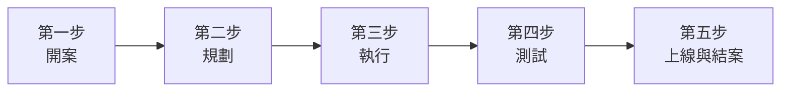

# 06 情境案例：一個專案從開始到結案

[← 回目錄](../README.md)

> **本章你會學到**：前面各章介紹的功能，在真實工作中是怎麼串在一起使用的。本章用一個虛構的「官網改版」專案，從開案一路走到結案。每一步都附上對應章節的連結，需要詳細操作時可以點過去看。

> 本章的公司、人名與內容皆為虛構。

## 角色介紹

| 人物 | 身分 | 在 Redmine 中的角色 |
|---|---|---|
| 王小明 | 專案經理 | 管理人員 |
| 陳美玲 | 設計師 | 開發人員 |
| 李大華 | 前端工程師 | 開發人員 |
| 張志強 | 測試人員 | 報告人員 |
| 林小君 | 行銷部窗口（需求方） | 報告人員 |

**專案目標**：在 2026 年 12 月底前完成公司官網改版，分兩個階段上線。

## 第一步：開案

**王小明**建立專案並加入成員。

1. 建立專案「官網改版 2026」，代碼 `website-2026`，不勾選「公開」。啟用「議題追蹤」、「工時追蹤」、「Wiki」、「檔案」、「甘特圖」、「日曆」模組，追蹤標籤勾選「臭蟲」、「功能」、「支援」。→ [5.1 建立專案](05-project-manager.md#51-建立專案)
2. 加入成員：陳美玲、李大華為「開發人員」，張志強、林小君為「報告人員」，自己為「管理人員」。→ [5.2 加入專案成員](05-project-manager.md#52-加入專案成員)
3. 在 Wiki 首頁寫下專案目標、範圍、時程與聯絡窗口，並用 `{{toc}}` 產生目錄。→ [5.9 Wiki、文件與新聞](05-project-manager.md#59-wiki文件與新聞)

## 第二步：規劃

**王小明**把專案拆成版本與議題。

1. 建立兩個版本：→ [5.3 設定版本](05-project-manager.md#53-設定版本里程碑)
   - 「第一階段：首頁與形象頁」，日期 2026-11-20
   - 「第二階段：會員中心」，日期 2026-12-20
2. 建立議題分類「設計」、「前端」，並設定自動分派給陳美玲、李大華。→ [5.4 設定議題分類](05-project-manager.md#54-設定議題分類)
3. 建立一筆父議題「首頁改版」，底下拆成子議題：→ [5.6 子議題與關聯議題](05-project-manager.md#56-子議題與關聯議題)
   - #101 首頁視覺設計（分類：設計）
   - #102 首頁切版（分類：前端）
   - #103 首頁 RWD 調整（分類：前端）
4. 設定 #101「優先於」#102，之後設計稿如果延誤，切版的日期會自動往後推。
5. 每筆議題填上開始日期、完成日期與預估工時，打開甘特圖檢查時程是否合理。→ [5.7 甘特圖](05-project-manager.md#57-甘特圖)

## 第三步：執行

**陳美玲**和**李大華**開始動工。

1. 每天上班先看「帳戶首頁」的「分派給我的議題」。→ [2.4 我的頁面](02-getting-started.md#24-我的頁面)
2. 陳美玲開始設計時，把 #101 狀態改為「實作中」。完成後上傳設計稿附件，狀態改為「已解決」，並在筆記中 `@dahua` 通知李大華可以開始切版。→ [3.3 更新議題](03-member.md#33-更新議題與回報進度)、[3.4 提及同事](03-member.md#34-提及同事50)
3. 兩人每天下班前記錄工時，活動分別選「設計」與「開發」。→ [3.7 記錄工時](03-member.md#37-記錄工時)
4. 李大華在切版時發現設計稿缺少手機版選單樣式，用筆記詢問陳美玲。討論中涉及內部排程的部分，勾選「私人筆記」，避免需求方看到。→ [3.5 私人議題與私人筆記](03-member.md#35-私人議題與私人筆記)

**王小明**每週一追蹤進度：

1. 打開自訂查詢「各人工作量」，確認沒有人工作量過重。→ [5.5 分派與追蹤工作](05-project-manager.md#55-分派與追蹤工作)
2. 打開自訂查詢「已逾期」，針對逾期的議題和負責人討論。
3. 看「版本藍圖」中第一階段的完成比例，寫成週報寄給主管。→ [5.8 路線圖與行事曆](05-project-manager.md#58-路線圖與行事曆)

## 第四步：測試

**張志強**在測試站驗收第一階段。

1. 發現「登入頁面在 Safari 無法送出」，建立追蹤標籤為「臭蟲」的議題 #128，依照錯誤回報範本填寫重現步驟並附上截圖，目標版本選「第一階段」。→ [3.2 建立議題](03-member.md#32-建立議題)
2. 王小明把 #128 分派給李大華，優先權設為「高」。
3. 李大華修正後把狀態改為「已解決」。
4. 張志強重新測試：
   - 通過：把狀態改為「已結束」。
   - 沒通過：把狀態改回「實作中」，並在筆記說明還有什麼問題。

> 為什麼張志強可以結案、李大華卻只能改到「已解決」？這是本案例的站台在工作流程中這樣設定的，讓「修的人」和「驗的人」分開。設定方式見 [7.7 工作流程](07-administrator.md#77-工作流程)。

**林小君**（需求方）也在測試時提出新想法「首頁想加上最新消息輪播」。王小明評估後，把這筆議題的目標版本設為「第二階段」，避免影響第一階段上線時程。

## 第五步：上線與結案

**王小明**完成第一階段的收尾：

1. 確認版本藍圖中「第一階段」的議題全部結案。
2. 把版本狀態改為「已結束」。→ [5.3 設定版本](05-project-manager.md#53-設定版本里程碑)
3. 在「新聞」發布「官網第一階段上線」公告，所有成員都會收到通知。
4. 打開工時報告，以「用戶」和「活動」統計第一階段的實際工時，和預估工時比較，作為第二階段估算的參考。→ [5.10 工時報表](05-project-manager.md#510-工時報表)

第二階段以同樣的流程進行。全部完成後，王小明在專案概觀頁右上角的「…」選單按下「關閉」，專案轉為唯讀，資料完整保留供日後查詢。→ [5.12 結束與封存專案](05-project-manager.md#512-結束與封存專案)

## 回顧：這個案例用到的功能

| 階段 | 用到的功能 |
|---|---|
| 開案 | 建立專案、模組、成員與角色、Wiki |
| 規劃 | 版本、議題分類、子議題、關聯議題、甘特圖 |
| 執行 | 我的頁面、狀態更新、@ 提及、私人筆記、記錄工時、自訂查詢、路線圖 |
| 測試 | 錯誤回報、分派、工作流程 |
| 結案 | 版本結束、新聞、工時報表、結束專案 |

---

上一章：[← 05 專案經理操作](05-project-manager.md)｜下一章：[07 系統管理員操作 →](07-administrator.md)
