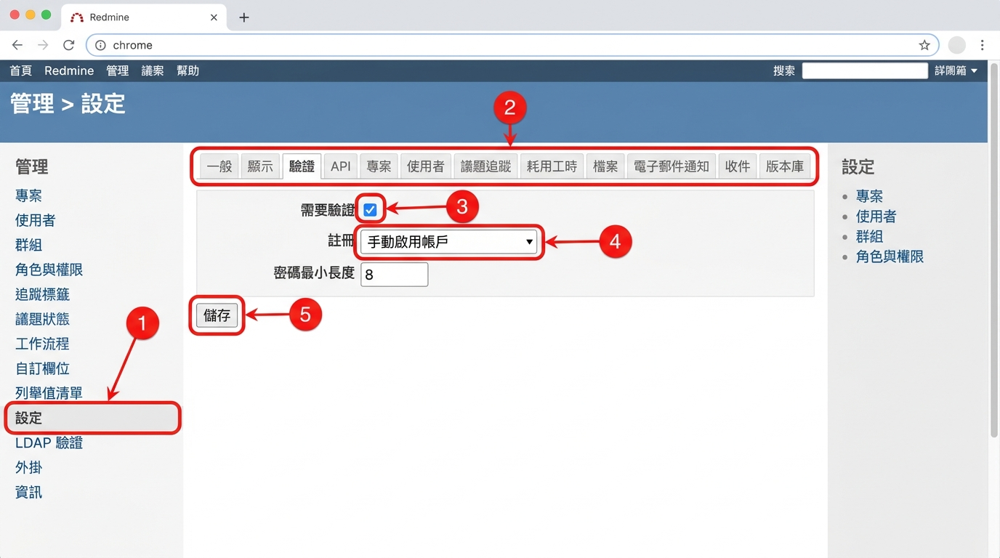
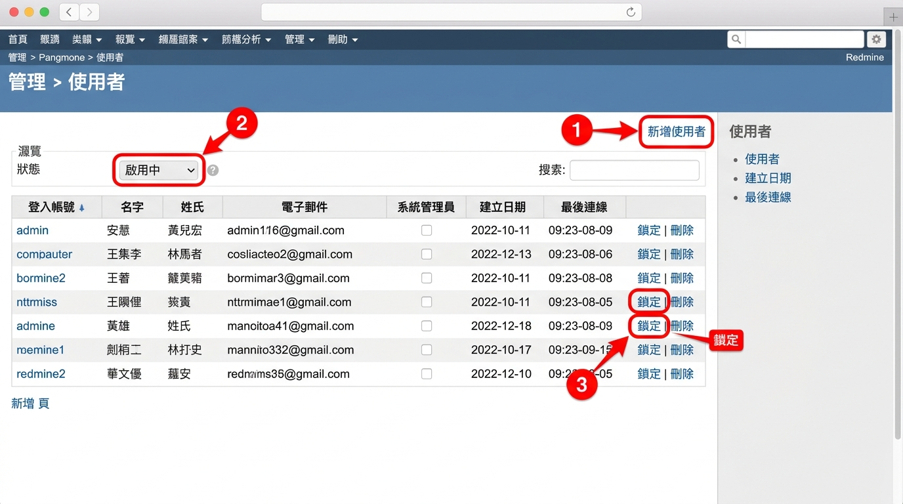
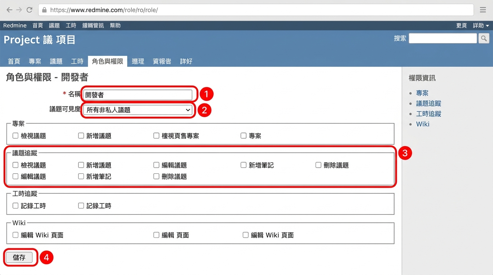
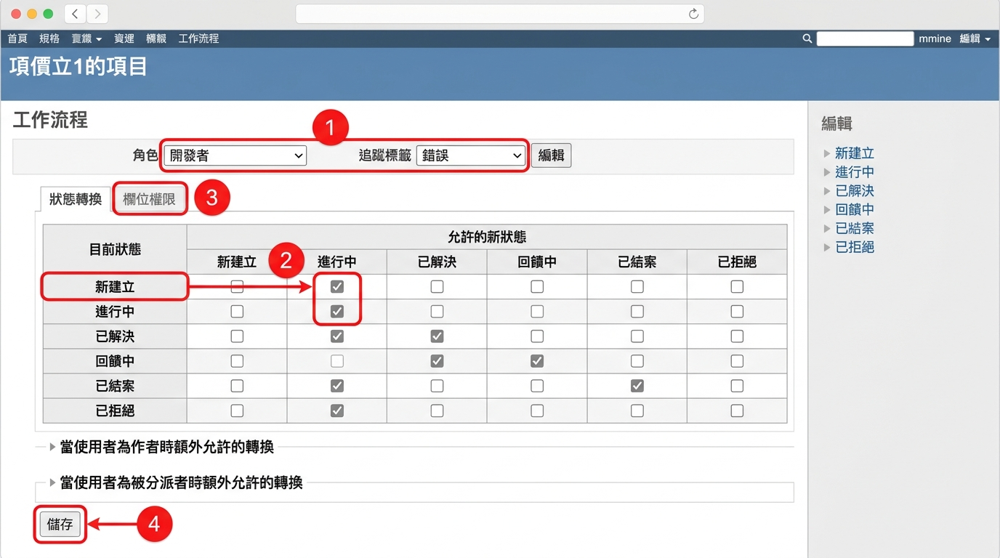
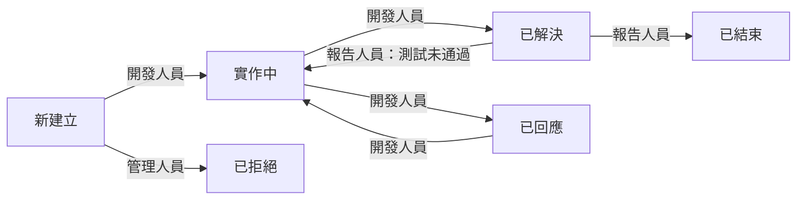

# 07 系統管理員操作

[← 回目錄](../README.md)

> **本章你會學到**：Redmine 後台的完整設定流程，包括系統設定、使用者與群組、角色權限、追蹤標籤、議題狀態、工作流程、自訂欄位、收信與安全性設定。

> 本章所有操作都在頂端列的「網站管理」選單內，只有系統管理員看得到。

## 7.0 建議的設定順序

初次架設 Redmine 時，建議依照以下順序設定，可以避免來回修改：

1. 載入預設設定（全新安裝時，見 [1.4 載入預設設定](01-quick-try.md#14-載入預設設定)）
2. 系統設定（一般、顯示、驗證、電子郵件通知、文字格式）
3. 議題狀態
4. 追蹤標籤
5. 角色與權限
6. 工作流程
7. 自訂欄位與列舉值清單
8. 使用者與群組
9. 建立專案並加入成員

## 7.1 系統設定

1. 進入「網站管理」→「設定」。
2. **一般** 分頁：設定「標題」、「歡迎詞」、「主機名稱」與「協定」（影響通知信中的連結是否正確），以及「文字格式」（建議選 CommonMark Markdown，見 [4.1](04-formatting.md#41-先確認你的站台用哪一種格式)）。
3. **顯示** 分頁：「預設語言」設為「Chinese/Traditional (繁體中文)」，設定「日期格式」、「時間格式」與「用戶顯示格式」。
4. **驗證** 分頁：
   - 「需要驗證」：勾選後，未登入者無法瀏覽任何內容。
   - 「註冊選項」：可選擇「關閉」、「透過電子郵件啟用帳戶」、「手動啟用帳戶」、「自動啟用帳戶」。
   - 「密碼最小長度」與「密碼必要的字元類別」。
   - 「雙因素驗證」（4.2+），見 [7.11 安全性設定](#711-安全性設定)。
5. **議題追蹤** 分頁：設定「允許關聯至其它專案的議題」、「父議題屬性」的計算方式、「計算議題完成比例之方式」等。
6. **電子郵件提醒選項** 分頁：設定「寄件者電子郵件」，並可按「寄送測試郵件」確認寄信設定是否正常。

**依使用情境的設定建議**

| 設定項目 | 公司內部團隊 | 開源或對外社群專案 |
|---|---|---|
| 需要驗證 | 勾選 | 不勾選，讓訪客可以瀏覽公開專案 |
| 註冊選項 | 關閉，或手動啟用帳戶 | 透過電子郵件啟用帳戶 |
| 新建立之專案預設為「公開」 | 否 | 視需求 |
| 「匿名者」角色權限 | 全部取消 | 只給檢視權限 |
| 雙因素驗證 | 建議設為「必要項」，至少「管理員必要項」 | 「選用項」 |

> 寄信需要的 SMTP 伺服器設定不在網頁介面，而是在伺服器上的 `config/configuration.yml` 檔案中設定，詳見 [09 伺服器維運](09-server-maintenance.md)。

## 7.2 使用者管理

**新增使用者**

1. 進入「網站管理」→「用戶清單」，點「建立新用戶」。
2. 填寫「帳戶名稱」、「名字」、「姓氏」、「電子郵件」。
3. 設定初始密碼，或勾選「產生密碼」並勾選「寄送帳戶資訊電子郵件給用戶」。建議同時勾選「必須在下次登入時變更密碼」。
4. 若此人需要管理後台，勾選「管理者」。
5. 按「建立」。

**停用使用者**

人員離職時，建議將狀態改為「鎖定」而非刪除，以保留其議題與工時歷史。

1. 在「用戶清單」找到該人員，在該列按右鍵（或點該列最右邊的「…」），選「鎖定」。

> 人數多時可以用 CSV 一次匯入使用者，見 [8.3 CSV 匯入](08-integration.md#83-csv-匯入)；公司已有 AD 或 LDAP 帳號系統時，可以直接串接，見 [7.11 安全性設定](#711-安全性設定)。

## 7.3 群組管理

1. 進入「網站管理」→「群組清單」，點「建立新群組」。
2. 輸入群組名稱，例如「前端組」、「PM 組」，按「建立」。
3. 在「用戶清單」分頁加入成員。
4. 在「專案清單」分頁可直接將群組加入多個專案並指定角色。

## 7.4 角色與權限

1. 進入「網站管理」→「角色與權限」。
2. 載入預設組態後會有「管理人員」、「開發人員」、「報告人員」三個角色，可直接修改或點「建立新角色」。
3. 進入角色後，依模組勾選權限，例如：
   - **專案**：編輯專案、管理成員、管理版本。
   - **議題追蹤**：檢視議題、新增議題、編輯議題、新增筆記、刪除議題、管理子任務、設定筆記為私人筆記、檢視私人筆記。
   - **工時追蹤**：紀錄耗用工時、檢視耗用工時、編輯自己的工時記錄。
   - **Wiki**：檢視 wiki、編輯 wiki 頁面。
4. 「議題可見度」可設定為「所有議題」、「所有非私人議題」或「使用者所建立的或被分派的議題」。
5. 按「儲存」。
6. 點清單下方的「權限報表」，可以用一張大表一次比較所有角色的權限。

> 「非會員」與「匿名者」是兩個特殊的內建角色，分別代表已登入但不是專案成員的人，以及未登入的訪客。若專案資料需保密，請確認這兩個角色的權限已收緊。

常見角色的權限建議，請見 [附錄 C 角色權限建議](appendix-c-role-permissions.md)。

## 7.5 追蹤標籤

1. 進入「網站管理」→「追蹤標籤清單」，點「建立新的追蹤標籤」。
2. 輸入名稱，例如「任務」、「需求」。
3. 選擇「預設狀態」（新建議題時的初始狀態）。
4. 勾選此追蹤標籤要顯示的「標準欄位」與「自訂欄位」。
5. 勾選要套用的專案。
6. 按「建立」。

> 新增追蹤標籤時，可以在「從以下追蹤標籤複製工作流程」選擇一個現有的追蹤標籤，省去從頭設定工作流程的麻煩。

> 想把預設的「臭蟲」改成「錯誤」這類較常用的名稱時，在清單中點該追蹤標籤，修改名稱後儲存即可，既有議題會自動套用新名稱。議題狀態、優先權等預設名稱也可以用同樣方式修改。

## 7.6 議題狀態

1. 進入「網站管理」→「議題狀態清單」，點「建立新狀態」。
2. 輸入名稱，例如「待確認」、「測試中」。
3. 若此狀態代表工作已完成，勾選「議題已結束」。這類狀態的議題不會出現在「狀態：進行中」的篩選結果中。
4. 可設定「完成比例」，讓議題切換到此狀態時自動帶入進度（需在系統設定中將「計算議題完成比例之方式」設為「依據議題狀態」）。
5. 用拖曳調整順序，順序會影響下拉選單的排列。

## 7.7 工作流程

工作流程決定「某個角色」在「某種追蹤標籤」上，可以把議題從哪個狀態改成哪個狀態。**新增追蹤標籤或狀態後，若沒有設定工作流程，使用者會無法變更議題狀態。**

1. 進入「網站管理」→「流程」。
2. 在上方選擇「角色」與「追蹤標籤」，按「編輯」。
3. 表格的列代表「目前狀態」，欄代表「可變更至以下狀態」，勾選允許的轉換。
4. 下方兩個區塊可另外設定「用戶為作者時額外允許的流程轉換」與「用戶為被分派者時額外允許的流程轉換」。
5. 切換到「欄位權限」分頁，可設定某狀態下特定欄位為「唯讀」或「必填」，例如進入「已解決」時必須填寫解決說明。
6. 按「儲存」。
7. 若要複製現有設定，點右上角的「複製」，把某角色或追蹤標籤的流程套用到其他組合。

### 常見的工作流程範例

這是一個「修的人和驗的人分開」的設定，也是 [06 情境案例](06-case-study.md) 使用的流程：

- 開發人員：可從「新建立」改為「實作中」、「實作中」改為「已解決」或「已回應」。
- 報告人員：可從「已解決」改為「已結束」，或退回「實作中」。
- 管理人員：可做任何轉換。

## 7.8 自訂欄位

1. 進入「網站管理」→「自訂欄位清單」，點「建立新自訂欄位」。
2. 選擇欄位要套用的物件，例如議題、專案、使用者、耗用工時。
3. 選擇格式：文字、長文字、整數、浮點數、日期、布林值、清單、使用者、版本、連結、附件等。
4. 設定名稱，以及「必填」、「用來作為篩選器」、「可用做搜尋條件」。
5. 若為議題欄位，勾選要套用的追蹤標籤與專案（或勾選「給全部的專案」）。
6. 可在「可被看見」限定只有特定角色看得到。
7. 按「建立」。

> 自訂欄位很方便，但不要加太多。欄位越多，成員建立議題的負擔越重，填寫品質反而會下降。建議先從真正需要拿來篩選或統計的欄位開始。

## 7.9 列舉值清單

在「網站管理」→「列舉值清單」可維護以下下拉選項：

- **議題優先權**：預設為低、正常、高、速、急。
- **文件分類**：預設為使用手冊、技術文件，可再加入需求文件、會議記錄等。
- **活動 (時間追蹤)**：預設為設計、開發，可再加入測試、會議等。

每一類都可設定預設值、調整順序，或停用不再使用的選項。

## 7.10 收信設定

啟用收信後，使用者可以直接回覆通知信來更新議題，也可以讓外部人員寄信到指定信箱自動建立議題，很適合當作客服或 IT 支援的收件窗口。

收信需要在伺服器端設定，常見做法有兩種：

- **定期抓信**：在伺服器排程中執行 Redmine 內建的指令，定時從 IMAP 或 POP3 信箱抓取新郵件。
- **郵件伺服器轉交**：由郵件伺服器收到信後，透過 Redmine 提供的程式轉交給 Redmine。此方式需在「網站管理」→「設定」→「傳入的電子郵件」中勾選「啟用處理傳入電子郵件的服務」，並產生「傳入電子郵件網頁服務 API 金鑰」。

在「傳入的電子郵件」分頁還可以設定「截去郵件中包含下列值之後的內容」，例如加入 `--- 請在此行以上回覆 ---`，避免整串舊信件內容都被貼進筆記。

> 詳細指令與參數依安裝方式不同，請參考官方文件「Receiving emails」，連結見 [附錄 D](appendix-d-resources.md)。

## 7.11 安全性設定

**雙因素驗證（4.2+）**

在「網站管理」→「設定」→「驗證」中的「雙因素驗證」可設定為「關閉」、「選用項」、「管理員必要項」或「必要項」。啟用後，使用者在「我的帳戶」中用 Google Authenticator、Microsoft Authenticator 等驗證 App 綁定，之後登入都要輸入 6 位數驗證碼。

> 建議至少要求所有系統管理員啟用雙因素驗證，管理員帳號被盜的影響範圍最大。

**LDAP / Active Directory 驗證**

公司已有 AD 或 LDAP 時，可以讓使用者直接用公司帳號登入，不必另外記一組密碼。

1. 進入「網站管理」→「LDAP 驗證」，點「建立新驗證模式」。
2. 填寫 LDAP 伺服器的主機、連接埠、Base DN、連線用帳號密碼，建議啟用加密連線。
3. 填寫屬性對應，例如登入帳號屬性（AD 通常為 `sAMAccountName`，OpenLDAP 通常為 `uid`）、名字、姓氏、電子郵件。
4. 勾選「即時建立使用者」，使用者第一次用公司帳號登入時就會自動建立 Redmine 帳號。
5. 按「儲存」後點「測試」確認連線正常。

**其他建議**

- 正式環境一律使用 HTTPS。
- 定期檢查「網站管理」→「用戶清單」，鎖定離職人員與長期未登入的帳號。
- 系統管理員帳號不要多人共用，每位管理員使用自己的帳號，才能追蹤操作紀錄。

## 7.12 其他管理功能

- **外掛程式**：查看已安裝的外掛及其設定。外掛需由伺服器端安裝，無法從介面上傳，見 [8.4 外掛](08-integration.md#84-外掛)。
- **資訊**：查看 Redmine 版本、Ruby 與 Rails 版本、資料庫類型，以及檔案目錄的寫入權限檢查，回報問題時常需提供這些資訊。
- **專案清單**：列出所有專案，可封存、取消封存、複製或刪除專案，見 [5.11](05-project-manager.md#511-複製專案作為範本) 與 [5.12](05-project-manager.md#512-結束與封存專案)。

---

上一章：[← 06 情境案例](06-case-study.md)｜下一章：[08 進階功能與整合 →](08-integration.md)
