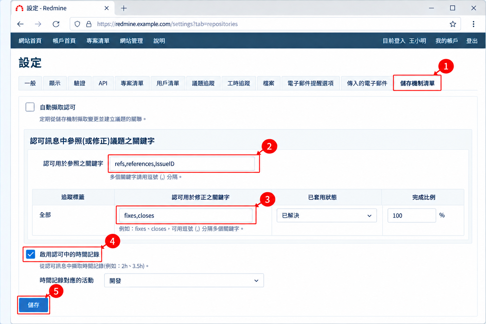
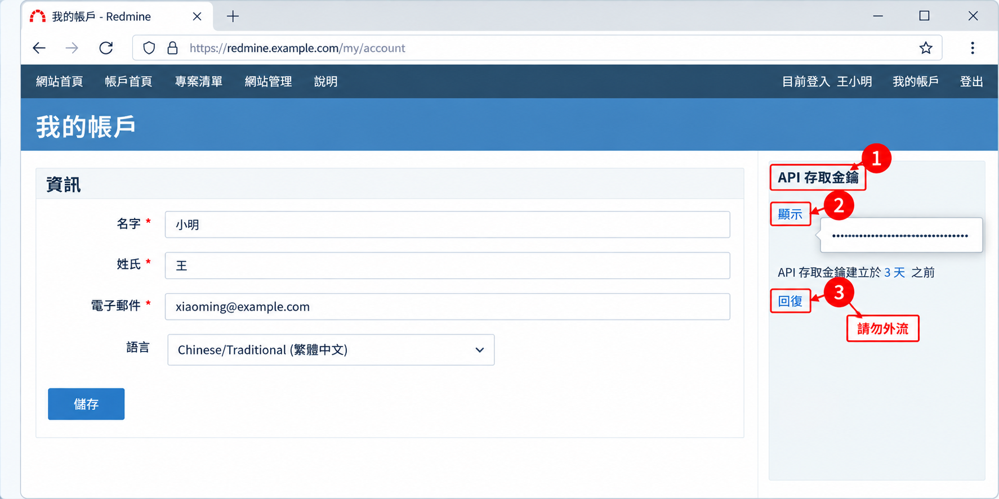
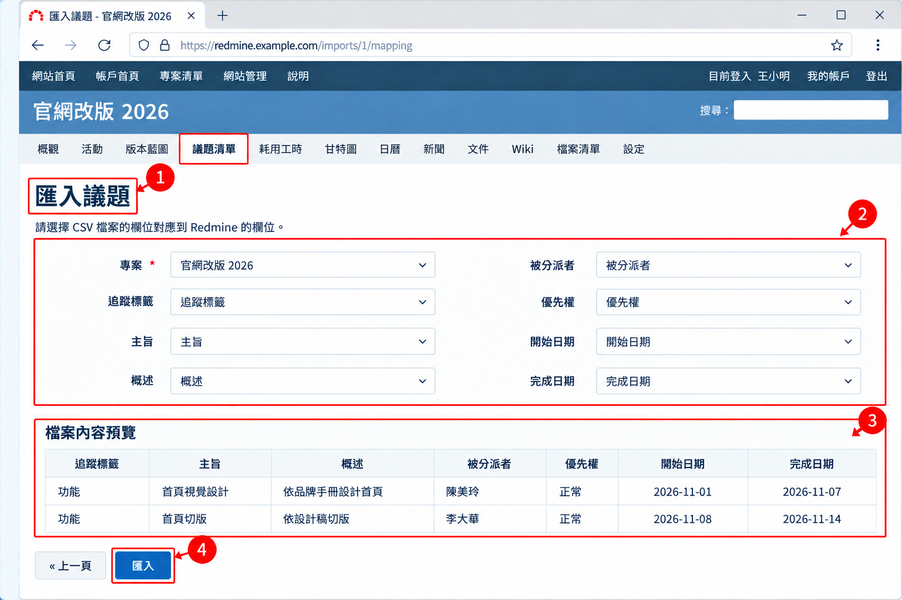

# 08 進階功能與整合

[← 回目錄](../README.md)

> **本章你會學到**：讓程式碼提交自動連結議題、用 REST API 串接其他系統、用 CSV 大量匯入資料，以及安裝外掛擴充功能。

> 本章部分內容需要系統管理員權限或伺服器存取權限。

## 8.1 版本庫整合

Redmine 可以連結 Git、Subversion 等版本庫。連結後，專案會多出「儲存機制」頁籤可以瀏覽程式碼，提交訊息中提到的議題也會自動互相關聯。

### 設定步驟

1. **伺服器準備**：Redmine 只能讀取「放在 Redmine 伺服器上」的 Git 版本庫。如果程式碼放在 GitHub、GitLab 等平台，需要先在伺服器上建立一份鏡像：

   ```bash
   git clone --mirror https://github.com/your-org/your-repo.git /var/repos/your-repo.git
   ```

   之後再用排程定期執行 `git fetch` 保持同步。
2. **啟用模組**：在專案「設定」→「專案」分頁的「模組」中勾選「版本控管」。
3. **新增版本庫**：在專案「設定」→「儲存機制清單」點「建立新儲存機制」，類型選 Git，在「儲存機制路徑」填入伺服器上的路徑（例如 `/var/repos/your-repo.git`）。
4. **設定關鍵字**：系統管理員到「網站管理」→「設定」→「儲存機制清單」設定以下項目。



### 參照關鍵字與修正關鍵字

| 類型 | 預設關鍵字 | 效果 |
|---|---|---|
| **參照關鍵字**（「認可用於參照之關鍵字」） | `refs`、`references`、`IssueID` | 提交會出現在議題的「關聯的修訂版」區塊 |
| **修正關鍵字**（「認可用於修正之關鍵字」） | 預設沒有，需自行設定 | 除了關聯，還會自動改變議題狀態與完成百分比 |

修正關鍵字的設定範例：在表格中新增一列，關鍵字填 `fixes, closes`，套用狀態選「已解決」，完成百分比選「100 %」。設定好之後，提交訊息這樣寫：

```bash
git commit -m "修正 Safari 無法送出登入表單 fixes #128"
```

Redmine 讀到這筆提交時，就會自動把 #128 改為「已解決」。

**順便記錄工時**：在同一頁勾選「啟用認可中的時間記錄」後，可以在關鍵字後面加上 `@` 與時數：

```bash
git commit -m "調整首頁 RWD 排版 refs #103 @1h30m"
```

### 讓 Redmine 讀到新的提交

Redmine 不會即時偵測版本庫的變化，有兩種方式更新：

- 在「網站管理」→「設定」→「儲存機制清單」勾選「自動擷取認可」，每次有人瀏覽版本庫頁面時就會更新。簡單，但大型版本庫可能讓頁面變慢。
- 關閉自動擷取，改用伺服器排程定期執行：

  ```bash
  bundle exec rails runner "Repository.fetch_changesets" -e production
  ```

## 8.2 REST API

REST API 可以讓其他程式讀取或寫入 Redmine 的資料，例如從監控系統自動建立錯誤議題、把議題同步到其他工具、製作自訂報表。

### 啟用與取得金鑰

1. 系統管理員到「網站管理」→「設定」→「API」，勾選「啟用 REST 網路服務技術（Web Service）」。
2. 使用者到「我的帳戶」，在右側「API 存取金鑰」點「顯示」即可看到自己的金鑰。



> API 金鑰等同你的帳號密碼，擁有和你相同的權限。不要貼在議題、Wiki 或公開的程式碼中。如果不小心外洩，可以在同一個位置點「回復」重新產生。

### 使用範例

查詢分派給自己的未結案議題：

```bash
curl -H "X-Redmine-API-Key: 你的金鑰" \
  "https://redmine.example.com/issues.json?assigned_to_id=me&status_id=open"
```

建立一筆新議題：

```bash
curl -X POST -H "Content-Type: application/json" \
  -H "X-Redmine-API-Key: 你的金鑰" \
  -d '{"issue": {"project_id": "website-2026", "subject": "監控警報：首頁回應過慢", "priority_id": 3}}' \
  "https://redmine.example.com/issues.json"
```

> `priority_id` 等編號依各站台的設定而不同，可以先用 `GET /enumerations/issue_priorities.json` 查詢。完整的 API 說明請見官方文件「Rest API」，連結見 [附錄 D](appendix-d-resources.md)。

> 很多程式語言都有現成的 Redmine API 套件，例如 Python 的 `python-redmine`，可以省去自己組 HTTP 請求的麻煩。

## 8.3 CSV 匯入

需要一次建立大量資料時，可以用 CSV 檔匯入，例如從舊系統搬移議題、批次建立帳號。

| 匯入對象 | 入口 |
|---|---|
| 議題（3.2+） | 專案的「議題清單」頁籤 → 右上角「…」選單 →「匯入」 |
| 耗用工時（4.1+） | 專案的「耗用工時」頁籤 → 右上角「…」選單 →「匯入」 |
| 使用者（4.2+） | 「網站管理」→「用戶清單」→ 右上角「…」選單 →「匯入」 |

### 匯入步驟

1. 準備 CSV 檔，第一列為欄位名稱，例如：

   ```csv
   追蹤標籤,主旨,概述,被分派者,優先權,開始日期,完成日期
   功能,首頁視覺設計,依品牌手冊設計首頁,陳美玲,正常,2026-11-01,2026-11-07
   功能,首頁切版,依設計稿切版,李大華,正常,2026-11-08,2026-11-14
   ```

2. 進入上表的匯入入口，選擇檔案後按「下一頁 »」。
3. 設定**選項**：欄位分隔符號（逗號或分號）、文字編碼（中文建議 UTF-8）、日期格式。
4. **對應欄位**：把 CSV 的每一欄對應到 Redmine 的欄位，畫面下方會顯示預覽。
5. 按「匯入」，完成後會顯示成功與失敗的筆數，失敗的列會列出原因。



> 「被分派者」等欄位必須填寫 Redmine 中已存在的使用者名稱，「追蹤標籤」必須是專案已啟用的類型，否則該列會匯入失敗。建議先用兩、三筆資料試匯入，確認沒問題再匯入全部。

## 8.4 外掛

外掛（Plugin）可以為 Redmine 加入原本沒有的功能，佈景主題（Theme）則可以改變外觀。

### 常見的外掛類型

| 類型 | 用途 |
|---|---|
| 看板 / 敏捷 | 以看板拖拉方式管理議題、衝刺規劃，例如 RedmineUP 的 Agile 外掛（有免費版與付費版） |
| 檢查清單 | 在議題中加入可勾選的待辦清單 |
| 議題範本 | 依追蹤標籤自動帶入預設的概述內容 |
| 客戶管理 / 服務台 | 把 Redmine 當作 CRM 或客服系統使用 |
| 佈景主題 | 讓介面更現代化，例如支援深色模式、響應式排版 |

可以到官方的外掛目錄依關鍵字搜尋，連結見 [附錄 D](appendix-d-resources.md)。

### 安裝外掛的一般流程

每個外掛的安裝方式略有不同，請以外掛的說明文件為準，一般流程如下：

1. **先備份**資料庫與 files 目錄，見 [9.3 備份](09-server-maintenance.md#93-備份)。
2. 確認外掛支援你的 Redmine 版本。這一步很重要，不相容的外掛可能導致整個系統無法啟動。
3. 把外掛資料夾放到 Redmine 的 `plugins/` 目錄下。
4. 在 Redmine 目錄執行：

   ```bash
   bundle install
   bundle exec rake redmine:plugins:migrate RAILS_ENV=production
   ```

5. 重新啟動 Redmine。
6. 到「網站管理」→「外掛程式」確認外掛已出現，並依需要調整設定與角色權限。

> 使用 [09 伺服器維運](09-server-maintenance.md) 的 Docker 架設方式時，把外掛放進 `/opt/redmine/plugins`，並在 `docker-compose.yml` 的 `environment` 加上 `REDMINE_PLUGINS_MIGRATE: "1"`，容器啟動時就會自動執行第 4 步的 migrate。外掛若需要額外的套件（gem），則要自行建立映像檔，請參考 Docker Hub 上的說明。

> 外掛越多，日後升級 Redmine 時越麻煩，因為每個外掛都要確認是否支援新版本。建議只安裝真正需要的外掛，並記錄每個外掛的用途與版本。

---

上一章：[← 07 系統管理員操作](07-administrator.md)｜下一章：[09 伺服器維運 →](09-server-maintenance.md)
